# OpenTelemetry for Beginners - The JavaScript Journey (Logs)

Getting started with OpenTelemetry can feel overwhelming, but this beginner series for JavaScript developers will guide you step by step.

This guide covers the **logs** signal and builds on everything we set up in the [Traces walkthrough](../traces/README.md) and the [Metrics walkthrough](../metrics/README.md).

> **New to the series?** Start with the [Traces walkthrough](../traces/README.md). It covers what OpenTelemetry is, the pipelines we'll build, the prerequisites, and how to clone the repo. Then continue with the [Metrics walkthrough](../metrics/README.md). This guide assumes you've completed those steps and can run the Roll the Dice app.

## Resources
- [OpenTelemetry documentation](https://opentelemetry.io/docs/)
  - Ask AI (⌘+K shortcut)
  - [Language APIs and SDKs](https://opentelemetry.io/docs/languages/)
  - [Logs](https://opentelemetry.io/docs/concepts/signals/logs/)
  - [OpenTelemetry Collector](https://opentelemetry.io/docs/collector/)
    - [List of OpenTelemetry Collector processors](https://github.com/open-telemetry/opentelemetry-collector-contrib/tree/main/processor)
  - [Transform processor (OTTL)](https://github.com/open-telemetry/opentelemetry-collector-contrib/tree/main/processor/transformprocessor)
- [OpenSearch documentation](https://docs.opensearch.org/)
- [OpenTelemetry YouTube channel](https://www.youtube.com/@otel-official)
  - [OpenTelemetry for Beginners series - The JavaScript Journey](https://youtu.be/iEEIabOha8U?feature=shared)
- [OpenTelemetry Slack channel](https://opentelemetry.io/community/end-user/slack-channel/)

# Episode 7 - Log Instrumentation & Bare-Bones Collector Configuration

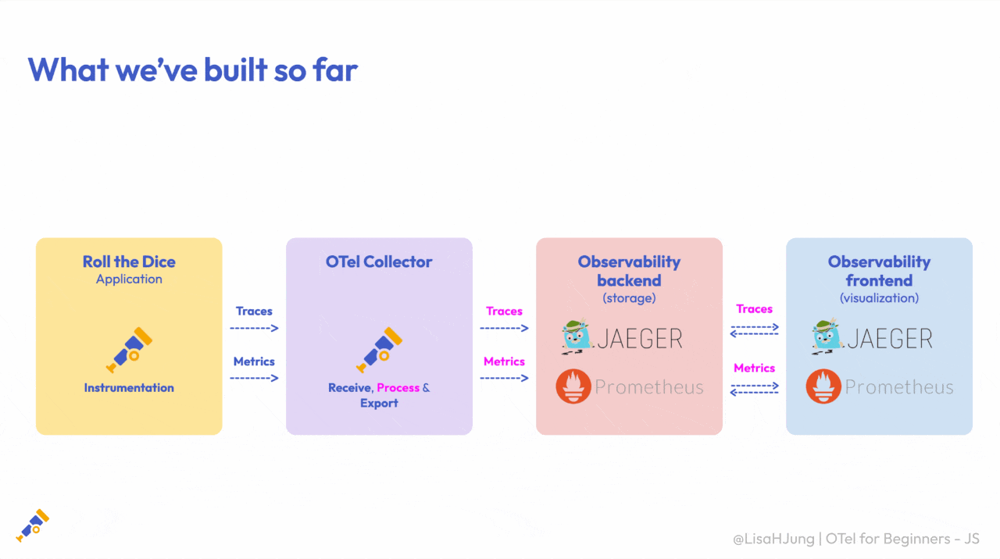

So far, we've covered two signals, traces and metrics. For each one, we instrumented our app, set up the OTel Collector to receive, process, and export the data, and then explored it in a backend.

Now it's time for our third signal, **logs**.

## What is a log?

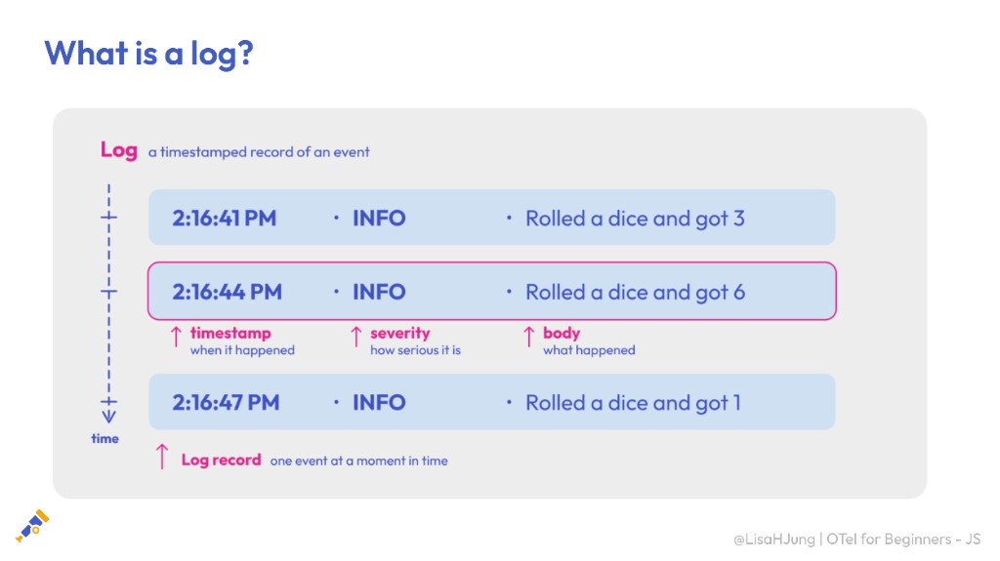

**Logs** are records of events that happen in our app. If you've ever debugged an app by reading through its output, you've already worked with logs.

Each row in this example is a single log, called a **log record**. It describes one event at a specific moment.

Let's take a closer look at one of them:
- The **timestamp** tells us when it happened.
- The **severity** tells us how serious it is.
- The **body** tells us what happened, in plain text.

Follow the timestamps, and you can see what our app did, one event at a time.

This is what sets logs apart from the other two signals.

A **trace** follows the path of a single request. **Metrics** give us the bigger picture across all requests. **Logs** tell us exactly what happened at a specific moment.

## The bare-bones setup

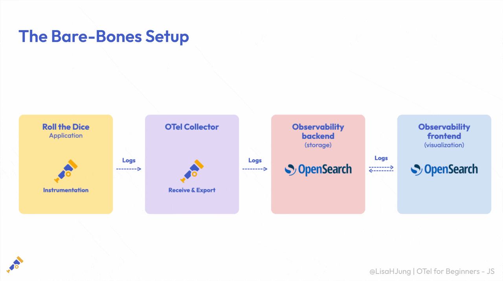

As with traces and metrics, we're starting small.

We'll configure a bare-bones OTel Collector to receive logs and export them to **OpenSearch**, the backend we'll use to store and search our logs. We'll explore them in **OpenSearch Dashboards**.

This setup lets us see our logs exactly as our app sends them. Once we know what they look like, the next episode adds processors to transform them before they're exported.

## Run the learning environment

If you've been following along, you should still have two terminals open. One for the Roll the Dice app and one for Docker.

In each one, we'll stop what's running and move to the `logs/bare-bones-setup` folder. It contains everything this episode needs, including the instrumentation, the Collector configuration, and a Docker setup that now includes OpenSearch and OpenSearch Dashboards.

**Terminal 1: restart the app**

> First, press **Ctrl + C** to stop the running app.

```bash
cd ../../logs/bare-bones-setup
npm install
npm start
```

**Terminal 2: restart the stack, now with OpenSearch**

> First, press **Ctrl + C** to stop the running Docker Compose session.

```bash
docker compose down
cd ../../logs/bare-bones-setup
docker compose up
```

> **Starting fresh?** From the directory where you cloned the repo, run `cd opentelemetry-for-beginners/javascript/logs/bare-bones-setup` in each terminal instead. Then run `npm install` and `npm start` in one, and `docker compose up` in the other.

**Generate some logs**

Once everything is running, head back to the Roll the Dice app at http://localhost:8080/rolldice and refresh the page a few times. Every roll creates a log record.

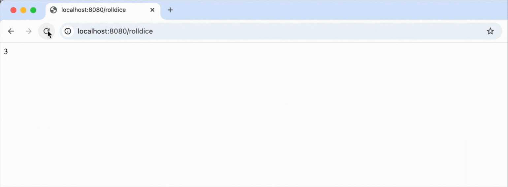

While you refresh, keep an eye on the terminal running Docker. That's where the Collector prints the logs it receives.

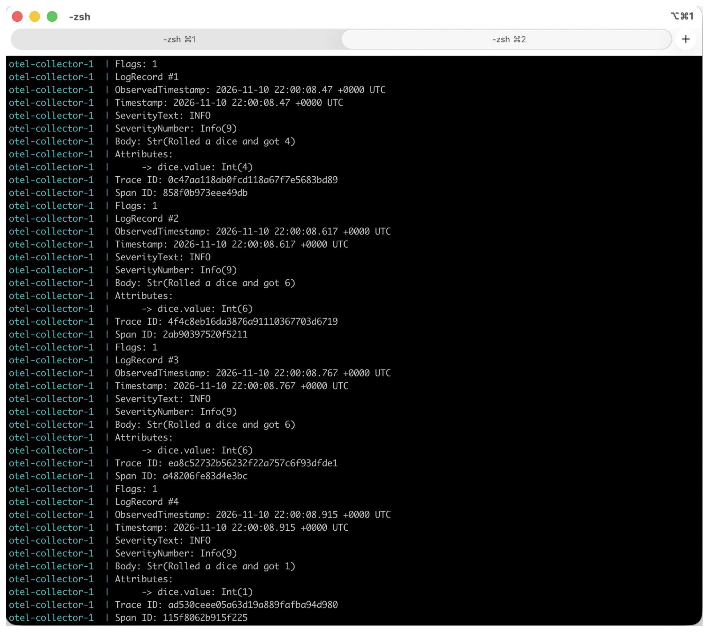

Our logs are batched before they're sent, so it may take a moment for them to appear. Once they do, they're easy to miss, because each log takes up much less space than the metrics output.

**Filter the Collector output**

To make our logs easier to spot, we can filter the Collector output down to just the log records.

Our other two terminals are busy running the app and Docker, so open a third terminal, move into the same `logs/bare-bones-setup` folder, and run this command.

**Terminal 3: show only the log records**

```bash
docker compose logs otel-collector -f | grep --line-buffered -A8 "LogRecord #"
```

Roll the dice a few more times, and each new log record shows up on its own.

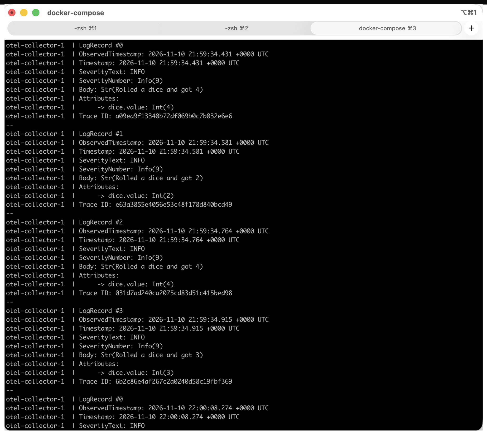

> **Tip:** Run `docker compose` commands from the `logs/bare-bones-setup` folder. From any other folder, Docker Compose won't find this stack's containers.

Our app is creating logs, and the Collector is receiving them. Next, let's dig into the code that makes it happen.

> **Quick heads-up.** To keep things easy to follow, some of the code snippets below only show the logs-related bits. Your actual files also include the traces and metrics setup from the earlier episodes, in `instrumentation.js` and the Collector config. We've just trimmed it out here so it's easier to focus on logs.

## The OTel packages

Open the `javascript/logs/bare-bones-setup` folder in your code editor, then open `package.json`.

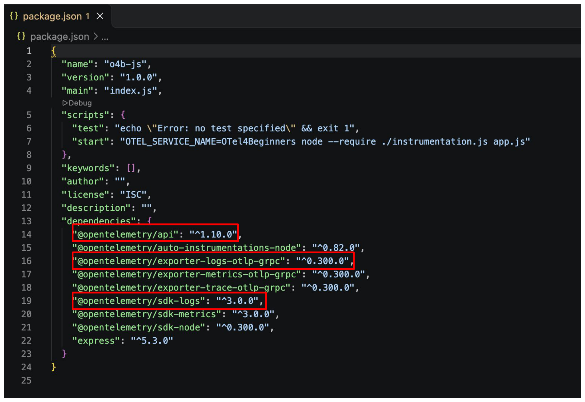

You'll recognize most of these packages from the earlier episodes. Three are new, and all three are there for logs:

- **`@opentelemetry/api`** is the OpenTelemetry API. It lets our app create log records in our code.
- **`@opentelemetry/sdk-logs`** is the Logs SDK. It collects those records and prepares them for export.
- **`@opentelemetry/exporter-logs-otlp-grpc`** is the OTLP log exporter. It sends those records to the Collector over gRPC.

> **Why didn't we need the API before?** In the traces and metrics episodes, auto-instrumentation did all the work, and our own code never called OpenTelemetry directly. The API was still installed, because the SDK and auto-instrumentation packages depend on it, but we didn't have to list it ourselves. Logs is the first time our own code uses the API, so we add it to `package.json`. The same package also includes the APIs for traces and metrics.

To see how these fit together, open `instrumentation.js`.

## instrumentation.js

This file should look familiar from our traces and metrics setup, with the logs pieces added.

```js
const opentelemetry = require('@opentelemetry/sdk-node');

const {
  getNodeAutoInstrumentations,
} = require('@opentelemetry/auto-instrumentations-node');

const {
  OTLPLogExporter,
} = require('@opentelemetry/exporter-logs-otlp-grpc');

const {
  BatchLogRecordProcessor,
} = require('@opentelemetry/sdk-logs');

const sdk = new opentelemetry.NodeSDK({
  // ...trace and metric configuration from the earlier episodes...
  logRecordProcessors: [
    new BatchLogRecordProcessor({
      exporter: new OTLPLogExporter({
        url: 'http://localhost:4317',
      }),
    }),
  ],
  instrumentations: [
    getNodeAutoInstrumentations({
      '@opentelemetry/instrumentation-router': { enabled: false },
    }),
  ],
});

sdk.start();
```

It does four main things:

1. **Imports the packages we need.**
   - Along with the OTel SDK and auto-instrumentation, we bring in the OTLP log exporter and the batch log record processor from the Logs SDK.
2. **Creates a Node SDK instance.**
3. **Exports our logs** to the Collector.
   - This is what's new. We add the batch log record processor and give it the log exporter to use.
   - The processor groups our logs into batches, and the exporter sends them to the Collector on port `4317`, the same port our traces and metrics use.
   - That's why our logs showed up in small groups after a short delay.
4. **Starts the SDK** so our app can generate and send logs.

> **Not the same as the Collector's processors and exporters.** The batch log record processor and the log exporter both run inside our app. They're separate from the processors and exporters we configure in the Collector.

The biggest change this time isn't in our setup files. It's in our app code.

## app.js

So far, we've relied on auto-instrumentation, meaning we haven't had to make any changes to our application code.

With logs, that changes. Our app doesn't use a logging library that OTel can instrument automatically.

So instead, we create our logs directly with the OpenTelemetry Logs API, which comes from the API package we saw in `package.json`.

```js
const { logs, SeverityNumber } = require('@opentelemetry/api');

const logger = logs.getLogger('rolldice-app');

app.get('/rolldice', (req, res) => {
  const roll = getRandomNumber(1, 6);

  logger.emit({
    severityNumber: SeverityNumber.INFO,
    severityText: 'INFO',
    body: `Rolled a dice and got ${roll}`,
    attributes: { 'dice.value': roll },
  });

  res.send(roll.toString());
});
```

Each roll calls `logger.emit()`, which creates a log record with three pieces of information:
- a **severity** of `INFO`, marking the roll as a routine event.
- a **body**, like `Rolled a dice and got 4`. This is the human-readable message we'll see in OpenSearch.
- a **`dice.value` attribute** that holds the rolled number in a field of its own, which makes it easy to search and filter by.

Right now, a one and a six get the same `INFO` severity. Keep that in mind, because it comes back in the next episode.

Writing telemetry in our own code like this is called **manual instrumentation**. It's how we capture the events that matter to our app when auto-instrumentation can't.

With our logs created and on their way, let's follow them into the Collector.

## Collector configuration

In your code editor, open `otel/otel-collector-config.yaml`.

```yaml
# otel/otel-collector-config.yaml
receivers:
  otlp:
    protocols:
      grpc:
        endpoint: 0.0.0.0:4317
      http:
        endpoint: 0.0.0.0:4318

exporters:
  debug:
    verbosity: detailed

  otlp_grpc/jaeger:
    endpoint: jaeger:4317
    tls:
      insecure: true

  prometheus:
    endpoint: 0.0.0.0:8889

  opensearch:
    http:
      endpoint: http://opensearch:9200
    logs_index: otel-logs

service:
  pipelines:
    traces:
      receivers: [otlp]
      exporters: [debug, otlp_grpc/jaeger]
    metrics:
      receivers: [otlp]
      exporters: [debug, prometheus]
    logs:
      receivers: [otlp]
      exporters: [debug, opensearch]
```

We're keeping this configuration bare-bones, so it only has receivers, exporters, and service pipelines. The processors and exporter batching from the earlier processing episodes come back in the next episode.

Our `otlp` receiver is the same one from earlier, so we'll skip ahead to the exporters and then the logs pipeline.

### Exporters

```yaml
# otel/otel-collector-config.yaml
exporters:
  debug:
    verbosity: detailed

  # ...otlp_grpc/jaeger and prometheus exporters from the earlier episodes...

  opensearch:
    http:
      endpoint: http://opensearch:9200
    logs_index: otel-logs
```

Exporters decide where the Collector sends our telemetry. For logs, we're using two of them.

- The **`debug`** exporter is the same one we used for traces and metrics. 
  - This time, it prints our logs to the Collector's output, so we can verify they're making it through.
- The **`opensearch`** exporter is the new addition.
  - For traces, we exported to Jaeger. For metrics, we exported to Prometheus. This time, we're sending our logs to OpenSearch, our backend for storing and searching logs.
  - It writes our logs to an index called `otel-logs`. We'll cover what an index is in just a bit.
  - OpenSearch Dashboards then reads from that index, so we can browse our logs.

### Service

```yaml
# otel/otel-collector-config.yaml
service:
  pipelines:
    logs:
      receivers: [otlp]
      exporters: [debug, opensearch]
```

Defining a receiver or exporter isn't enough to turn it on. A component only runs once we list it in a pipeline in the `service` section, which is where we wire up how data moves through the Collector.

Let's follow a log through our logs pipeline.

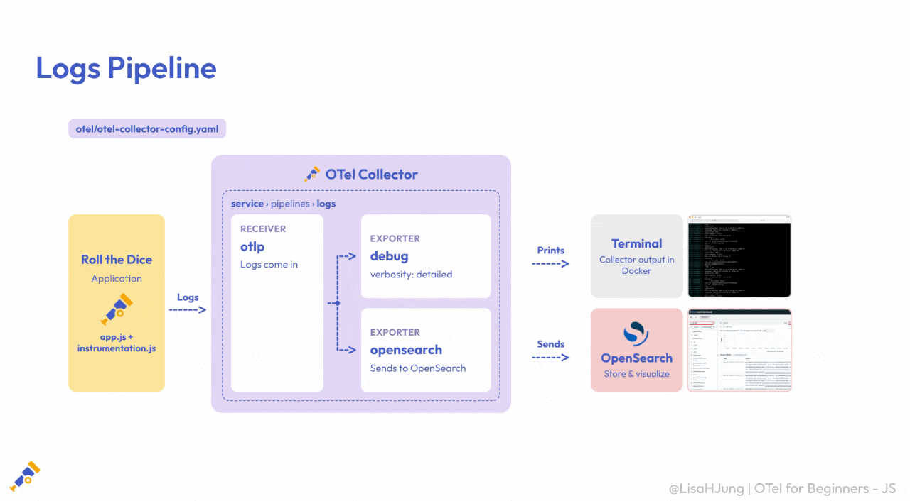

- A dice roll creates a log record, and our app sends it to the Collector.
- The **`otlp`** receiver accepts it and passes it to both exporters at the same time.
- The **`debug`** exporter prints it out, which is what we saw scrolling by in the Docker terminal.
- The **`opensearch`** exporter stores it in OpenSearch, ready for us to search.

That's the whole trip from our app to OpenSearch. Let's go find our logs!

## Explore our logs in OpenSearch Dashboards

**1. Open OpenSearch Dashboards**

Go to http://localhost:5601.

The first time you open it, you might see a pop-up about a new Discover experience. 

If you do, click **Dismiss**. Then, on the welcome screen, click **Explore on my own**.

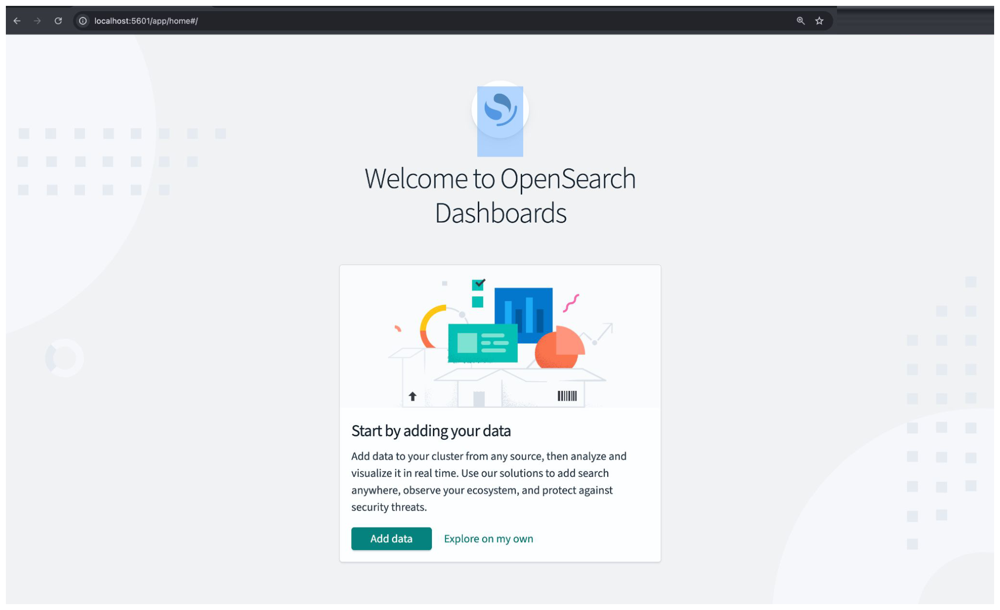

You'll land on the home page.

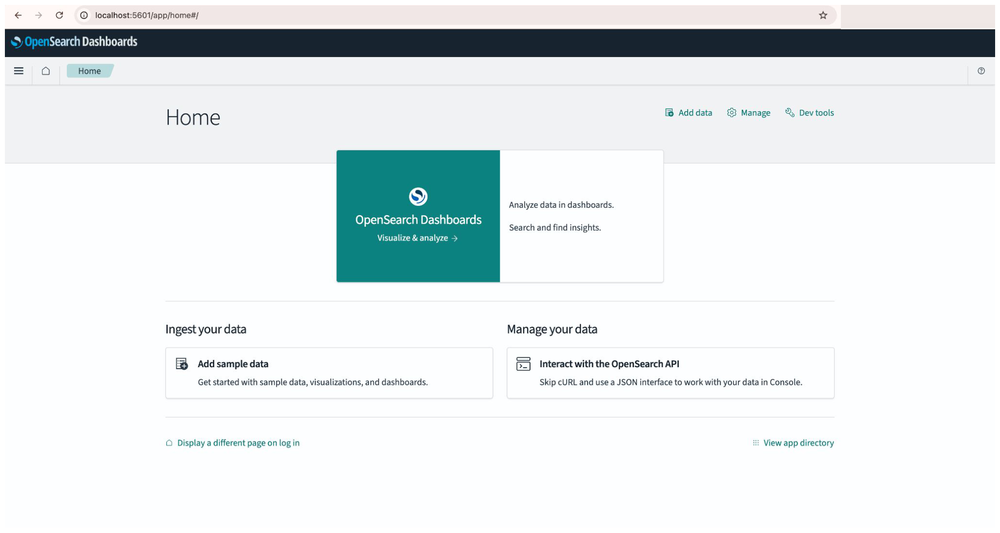

Our logs are already stored in OpenSearch, but we need one quick setup step before we can browse them.

### What's an index?

Remember the `logs_index` setting in our Collector config?

```yaml
# otel/otel-collector-config.yaml
exporters:
  opensearch:
    http:
      endpoint: http://opensearch:9200
    logs_index: otel-logs
```

Because `logs_index` is set to `otel-logs`, the Collector stores all our logs together under that name. OpenSearch calls this an **index**.

You can picture an index as a folder that holds related data, so it's easy to find later.

OpenSearch can hold many indexes, so OpenSearch Dashboards needs us to point it at the one we care about.

### What's an index pattern?

That's the job of an **index pattern**. It tells OpenSearch Dashboards which indexes to read from. We'll create one for `otel-logs`.

**2. Create the index pattern**

1. From the home page, click **Manage** in the top-right corner.

   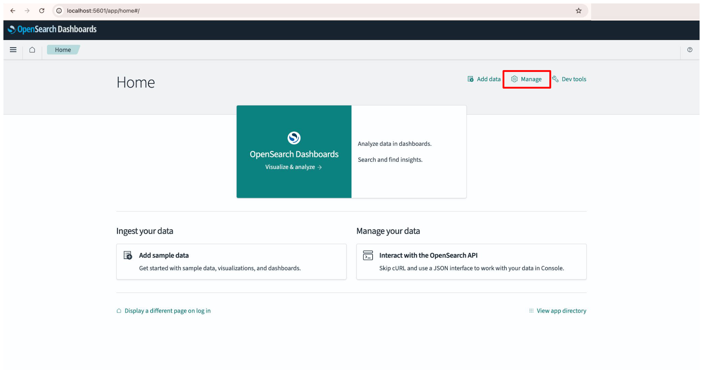

2. From the menu on the left, select **Index patterns**.

   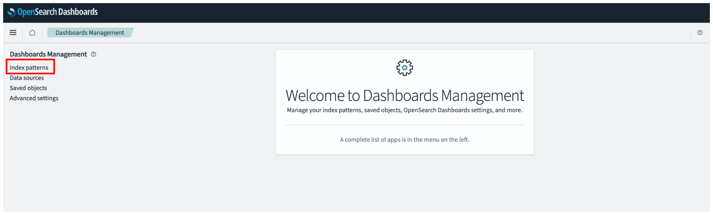

3. Click **Create index pattern**.

   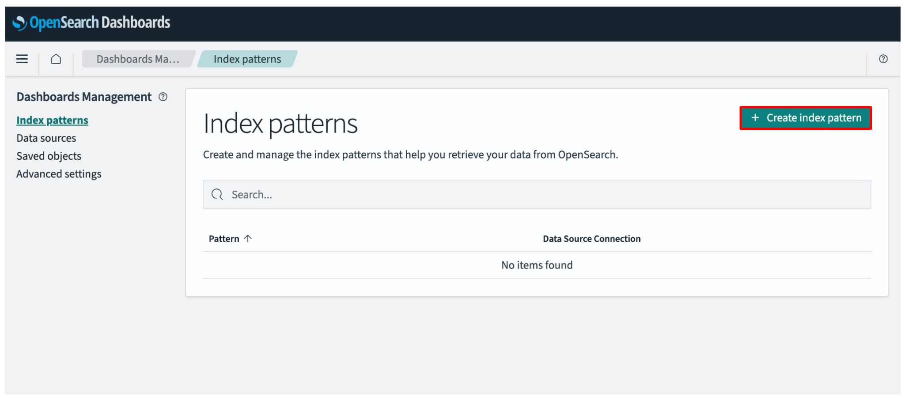

4. For the index pattern name, enter `otel-logs`. You'll see it match our `otel-logs` index below. Then click **Next step**.

   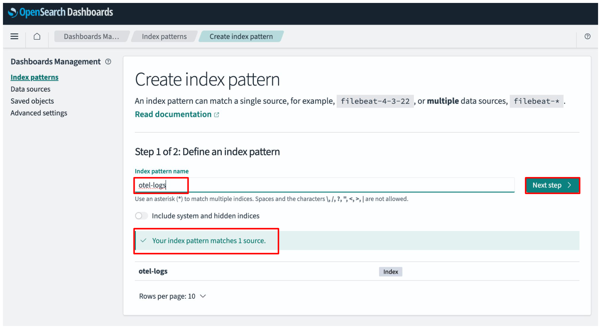

   > OpenSearch Dashboards adds an asterisk for you, so the pattern is saved as `otel-logs*`. It still matches only our `otel-logs` index.

5. Open the time field dropdown. 

  You'll see two options. Pick `@timestamp`, which is when the event happened in our app. That way, our logs appear on the timeline based on when we actually rolled the dice. Then click **Create index pattern**.

   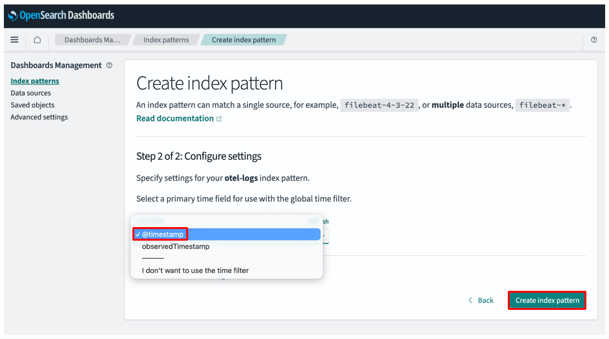

**3. View our logs in Discover**

1. Open the menu in the top-left corner and select **Discover**.

   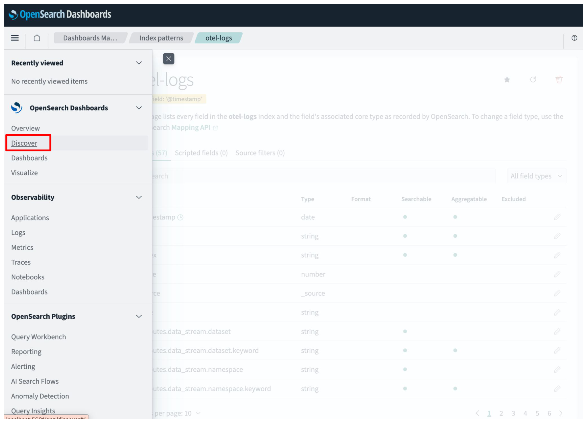

2. Make sure `otel-logs*` is selected in the dropdown near the top-left.
3. Our app only generates logs when we roll the dice. Head back to the Roll the Dice app and roll a few times.

   

4. Come back to **Discover**, set the time range to **Last 15 minutes**, and click **Refresh**.

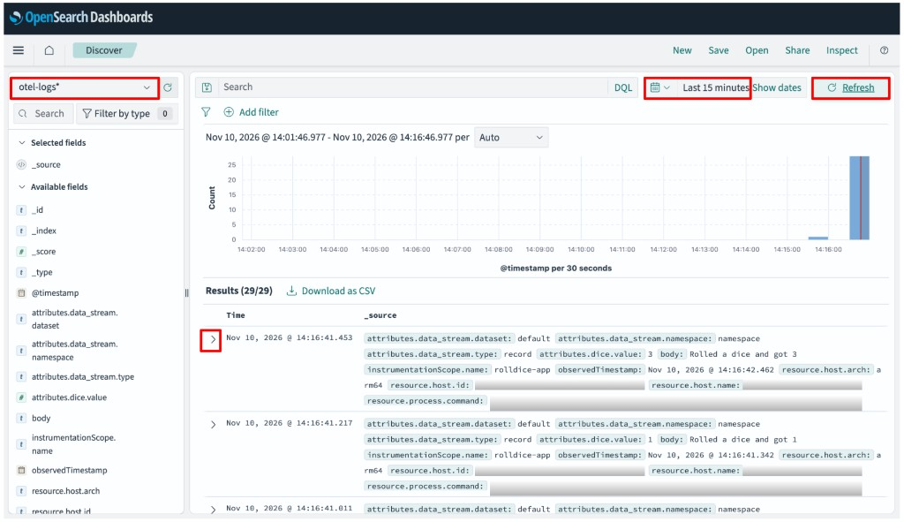

> **No results?** Give it a few seconds for the batch to come through, then click **Refresh** again. Also check the time range. With **Last 15 minutes**, logs older than 15 minutes drop out of view, so roll a few more times or pick a longer range.

You should now see your log records, with the newest at the top. Let's expand one by clicking the arrow at the start of its row and take a closer look.

### Inside a log record

**The body and attributes**

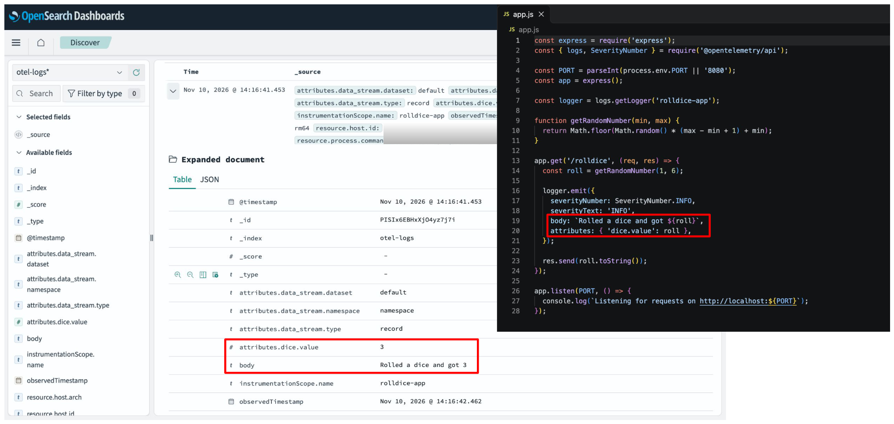

Remember the body and the `dice.value` attribute we set in `app.js`? Both made it through the Collector, and here they are in OpenSearch.

- **`body`** contains the message we created in our code, like `Rolled a dice and got 3`.
- **`attributes.dice.value`**, right above it, captures the value we rolled as an attribute.

They work as a pair. The body describes the event in words, and the attribute stores the key detail as data we can filter on.

> You'll also see a few `attributes.data_stream` fields. The OpenSearch exporter adds those when it writes our logs, so they don't come from our code.

**Resource attributes**

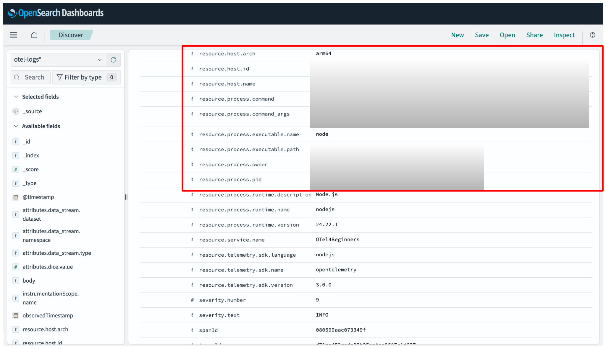

Scroll down a bit, and you'll find a group of fields that start with `resource`. These are our **resource attributes**, just like the ones we saw with [traces](../traces/README.md#process-resource-attributes) and [metrics](../metrics/README.md#resource-attributes).

They describe where a log came from, such as our app, the process running it, and the host. All our logs come from the same app instance, so these values are identical on every log, while `dice.value` changes from roll to roll.

Many of these details were added for us automatically. Some are handy to have, like `service.name`. Others are more than we need for this demo, like host identifiers, the process owner, and the command used to start our app.

In the next episode, we'll use processors to remove these:
- `host.arch`
- `host.id`
- `host.name`
- `process.command`
- `process.command_args`
- `process.executable.path`
- `process.owner`
- `process.pid`

**Severity**

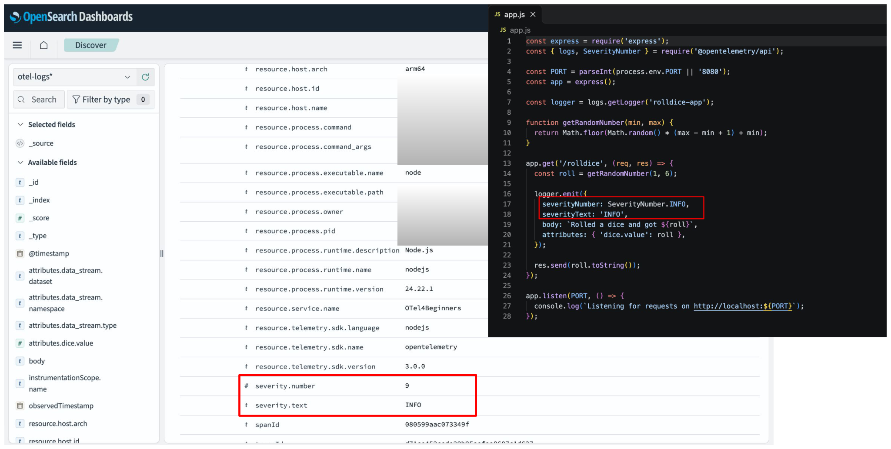

Keep scrolling to reach the **severity** fields, which show how important an event is.

These come straight from `app.js`. Our rolls are routine, so we set `severityNumber` to `SeverityNumber.INFO` and `severityText` to `'INFO'` in `logger.emit()`. In OpenSearch, they show up as `severity.number` and `severity.text`.

`severity.text` reads `INFO`, and `severity.number` is `9`. Don't mistake that `9` for a dice roll! It's OpenTelemetry's numeric code for `INFO`.

Next episode, our rolls get different severity levels, and we'll use those levels to choose which logs to keep.

**Trace context**

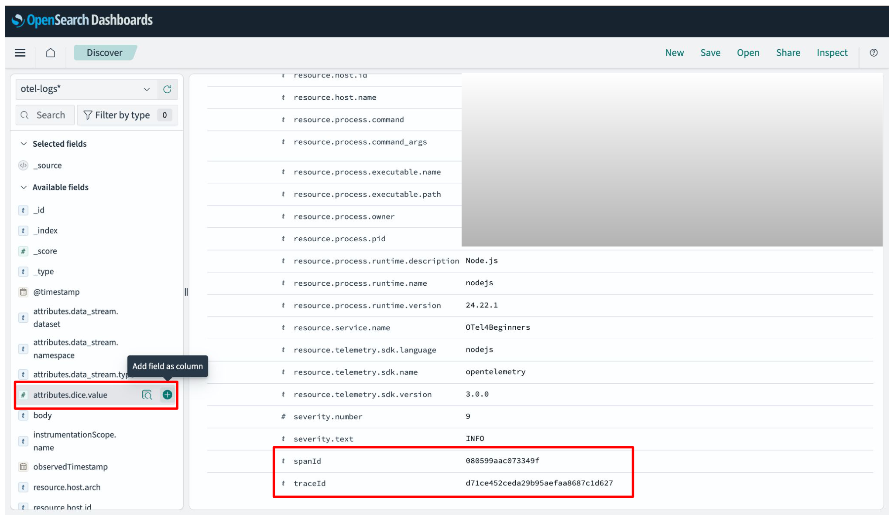

Finally, at the bottom of the record is the **trace context**, a `traceId` and a `spanId`. Notice that we never added these in our code.

Because this log was created during a traced request, OpenTelemetry attached them for us. 

The `traceId` connects this log to that request's trace. If we need more context about what happened, we can search for that trace ID in Jaeger and follow the request from start to finish.

So far, we've been looking at one log at a time. To compare several logs at a glance, we can turn fields into columns.

In the **Available fields** menu on the left, hover over `attributes.dice.value` and `severity.text`, and click the **Add field as column** button next to each one.

### Compare several logs at once
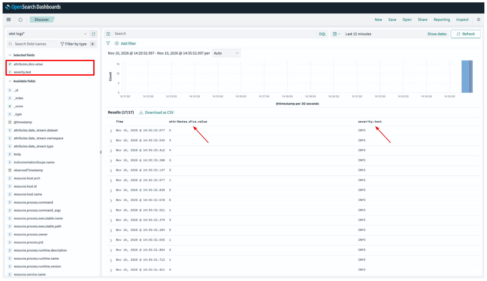

Now every row shows its dice value and severity right in the table. This view comes in handy next episode, when we compare our logs before and after processing.

And just like that, our logs pipeline is up and running!


In this episode, we wrote our first manual instrumentation with the OpenTelemetry Logs API, sent our logs through a bare-bones Collector, and explored them in OpenSearch Dashboards. 

Along the way, we unpacked a log record, from its body and attributes to its resource attributes, severity, and trace context.

Our logs are flowing, but they're still raw. 

In the next episode, processors are back, and we'll use them to clean up, enrich, and filter our logs before they leave the Collector.

# Episode 8 - Processing Logs: OpenTelemetry Collector in Action

In the last episode, we got our bare-bones logs pipeline running. Our app created logs, the Collector sent them to OpenSearch, and we explored them in OpenSearch Dashboards.

When we looked [inside a log record](#inside-a-log-record), a few things stood out:
- Our logs carried host and process details we don't need.
- Every roll came in with the same `INFO` severity, no matter what we rolled.
- We stored every single roll, even though we might not need all of them.

In this episode, we'll fix all three with **processors**.

## Processing logs with the OpenTelemetry Collector


Just like with traces and metrics, these changes happen inside the Collector, before our logs are exported.

We'll use three processors:
- The **`resource`** processor removes the resource attributes we don't need.
- The **`transform`** processor gives some of our dice rolls a different severity.
- The **`filter`** processor uses those severity levels to decide which logs to keep.

We'll also see how our logs get batched on their way to OpenSearch.

None of this requires touching our app's code. Everything happens in the Collector.

## Project folders

1. `javascript/logs/bare-bones-setup/` (**Episode 7**)
   - Instruments the Roll the Dice app and sends logs to the Collector.
   - The Collector exports logs to OpenSearch with no additional processing.

2. `javascript/logs/add-processors/` (**Current episode**)
   - Uses the same app and instrumentation as `bare-bones-setup`.
   - Adds processors to the Collector configuration that clean up, enrich, and filter our logs, and batches logs before exporting them to OpenSearch.

## Run the updated setup

You should still have two terminals open, one for the Roll the Dice app and one for Docker. If the third terminal with the filtered Collector output is still running, stop it with **Ctrl + C**.

In the other two, we'll stop what's running and switch to the `logs/add-processors` folder.

**Terminal 1: restart the app**

> First, press **Ctrl + C** to stop the running app.

```bash
cd ../add-processors
npm install
npm start
```

The `add-processors` folder has its own dependencies, so we run `npm install` before starting the app.

**Terminal 2: restart the stack with the new Collector config**

> First, press **Ctrl + C** to stop the running Docker Compose session.

```bash
docker compose down
cd ../add-processors
docker compose up
```

**Generate some logs**

Once everything's up, head back to the Roll the Dice app at http://localhost:8080/rolldice and refresh the page a few times.


If you're watching the terminal running Docker, you'll notice a lot fewer logs than last time. Most of our rolls don't show up at all.

That's our processors at work. Let's open the config and find out what they're doing.

## Collector configuration

In your code editor, open the `javascript/logs/add-processors` folder. Then open `otel/otel-collector-config.yaml`.

> **Quick heads-up.** Just like in the last episode, the snippets below only show the logs-related bits. Your actual file also includes the processors, exporters, and pipelines for traces and metrics from the earlier episodes. We've just trimmed them out here so it's easier to focus on logs.

```yaml
# otel/otel-collector-config.yaml
receivers:
  otlp:
    protocols:
      grpc:
        endpoint: 0.0.0.0:4317
      http:
        endpoint: 0.0.0.0:4318

processors:
  resource:
    attributes:
      - key: deployment.environment.name
        value: local
        action: insert
      - key: host.arch
        action: delete
      - key: host.id
        action: delete
      - key: host.name
        action: delete
      - key: process.command
        action: delete
      - key: process.command_args
        action: delete
      - key: process.executable.path
        action: delete
      - key: process.owner
        action: delete
      - key: process.pid
        action: delete

  # ...attributes/traces and filter/exclude_metrics processors from the earlier episodes...

  transform/logs:
    log_statements:
      - set(log.severity_number, SEVERITY_NUMBER_WARN) where log.attributes["dice.value"] == 1
      - set(log.severity_text, "WARN") where log.attributes["dice.value"] == 1

  filter/logs:
    log_conditions:
      - 'log.severity_number < SEVERITY_NUMBER_WARN'

exporters:
  debug:
    verbosity: detailed

  # ...otlp_grpc/jaeger and prometheus exporters from the earlier episodes...

  opensearch:
    http:
      endpoint: http://opensearch:9200
    logs_index: otel-logs
    sending_queue:
      sizer: items
      batch:
        flush_timeout: 5s
        min_size: 512

service:
  pipelines:
    # ...traces and metrics pipelines from the earlier episodes...
    logs:
      receivers: [otlp]
      processors: [resource, transform/logs, filter/logs]
      exporters: [debug, opensearch]
```

Compared with our bare-bones setup, there's a new section, `processors`. That's where we define the processors our pipelines use.

Each pipeline uses its own mix of processors, and only one, `resource`, is shared by all three.

Our logs pipeline uses three: `resource`, `transform/logs`, and `filter/logs`. Let's start with the one we already know.

### The resource processor

```yaml
# otel/otel-collector-config.yaml
processors:
  resource:
    attributes:
      - key: deployment.environment.name
        value: local
        action: insert
      - key: host.arch
        action: delete
      # ...the other host and process attributes...
      - key: process.pid
        action: delete
```

This is the same `resource` processor from the [traces](../traces/README.md#the-resource-processor) and [metrics](../metrics/README.md#the-resource-processor) episodes. It adds `deployment.environment.name` with the value `local`, and it deletes the host and process details we don't need.

Since all three pipelines share it, our logs get the same cleanup.

**Follow along in OpenSearch Dashboards**

Want to see the changes on your own setup? 

Open OpenSearch Dashboards at http://localhost:5601.

This is a brand-new stack, so OpenSearch Dashboards starts fresh. 

If the welcome pop-ups appear, dismiss them like last time. Then create the index pattern again, using the same [steps from the last episode](#explore-our-logs-in-opensearch-dashboards) with `otel-logs` as the name and `@timestamp` as the time field.

Once that's done, head to **Discover** and expand a log record.

**Before and after**

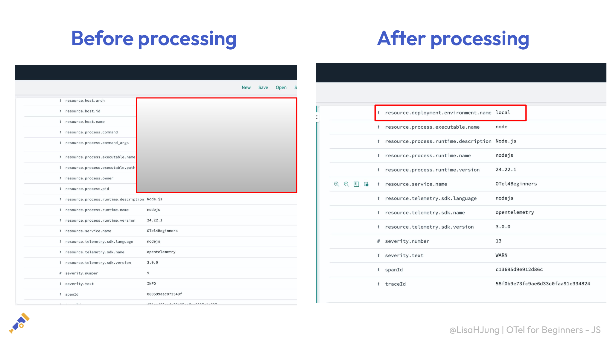

On the left is a log from our bare-bones setup, with all those `resource.host` and `resource.process` attributes. On the right is a processed log.

The host and process details are gone, and `deployment.environment.name` shows up with the value `local`.

One processor removed what we don't need and added useful context, and it does the same for all three signals.

### The transform processor

```yaml
# otel/otel-collector-config.yaml
processors:
  transform/logs:
    log_statements:
      - set(log.severity_number, SEVERITY_NUMBER_WARN) where log.attributes["dice.value"] == 1
      - set(log.severity_text, "WARN") where log.attributes["dice.value"] == 1
```

With our resource attributes cleaned up, let's change the log records themselves. That's what the `transform` processor is for.

It describes changes using the **OpenTelemetry Transformation Language**, or **OTTL**.

For our demo, let's say a roll of one is something we want to flag. 

Whenever `dice.value` is `1`, this processor raises the log's severity from `INFO` to `WARN`. That makes those rolls stand out, and we'll use the new severity in the next step to decide which logs to keep.

Flagging ones is just a choice for our demo. In your own app, you'd decide which events deserve attention.

**How the statements work**

Each line under `log_statements` follows the same pattern: `set(field, value) where condition`.
- **`set(...)`** changes a field on the log record.
- **`where ...`** limits the change to logs that match the condition. Here, that's logs where the `dice.value` attribute is `1`.

Every log stores its severity twice, once as a number and once as text. To change the severity, we update both:
- The first statement sets the number to `SEVERITY_NUMBER_WARN`, which is `13`. In Discover, this is the `severity.number` field, which showed `9` for `INFO` in the last episode.
- The second statement sets the text to `WARN`. In Discover, this is the `severity.text` field.

Together, they turn every roll of one from `INFO` into `WARN`, while every other roll stays `INFO`.

We won't go deeper into OTTL in this series. If you'd like to explore it, check out the [Transform processor (OTTL)](https://github.com/open-telemetry/opentelemetry-collector-contrib/tree/main/processor/transformprocessor) docs in the [Resources](#resources) section.

**Before and after**

Here's the table view from our bare-bones setup, with the dice value and severity side by side.

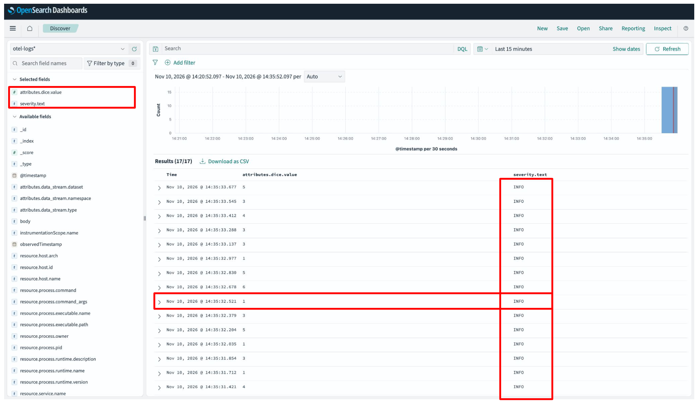

Every roll came in as `INFO`, no matter what we rolled.

To compare, let's set up the same view on our live dashboard. In the **Available fields** menu on the left, hover over `attributes.dice.value` and `severity.text`, and click the **Add field as column** button next to each one.

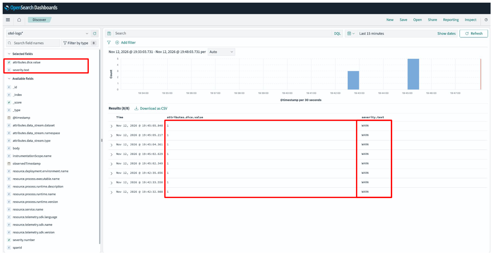

Now expand one of the records and scroll down to `attributes.dice.value`.

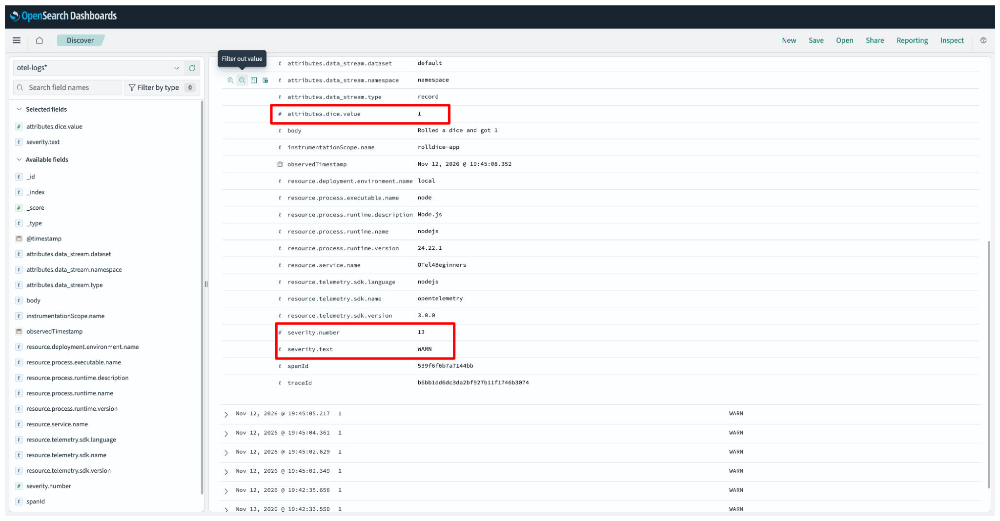

This is a roll of one. Its `severity.text` is now `WARN`, and `severity.number` went from `9` to `13`.

That's the `transform` processor doing exactly what we configured.

Now close the record and look at the rest of the table.

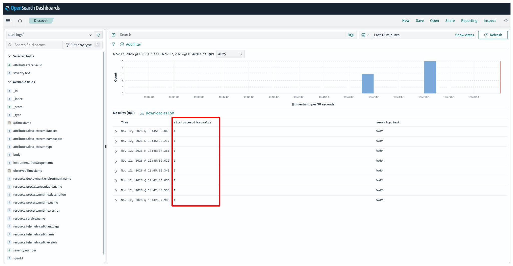

Here's where things get interesting. Every single log has a dice value of one, and it's pretty unlikely we rolled a one every time.

So where did the other rolls go? Our next processor has the answer.

### The filter processor

```yaml
# otel/otel-collector-config.yaml
processors:
  filter/logs:
    log_conditions:
      - 'log.severity_number < SEVERITY_NUMBER_WARN'
```

We used the `filter` processor in the [metrics episode](../metrics/README.md#the-filter-processor) to drop a metric we didn't need. This time, we're using it to keep only the logs we want.

Storing fewer logs means less data to keep around, which can help keep costs down.

Our condition under **`log_conditions`** drops any log with a severity below `WARN`.

Since `INFO` is below `WARN`, every roll except the ones gets dropped.

**Before and after**

Here's what our logs looked like in the bare-bones setup.

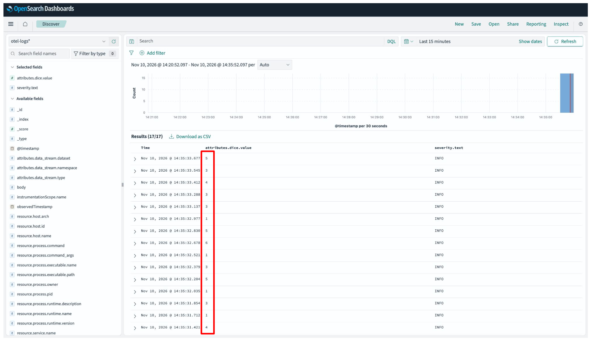

Every roll made it to OpenSearch, no matter what we rolled, and every one of them was `INFO`.

And here are our processed logs.

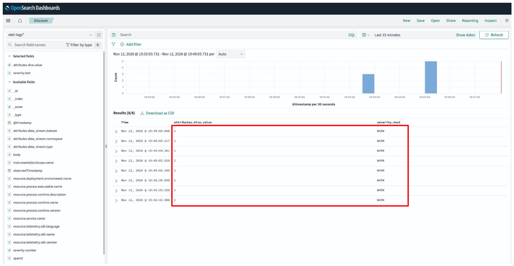

What's left is only rolls of one, all `WARN`. The rest never made it to OpenSearch.

Together, `transform` and `filter` let us flag the events we care about and drop the rest before they're stored.

### Batching in two places

With our processors covered, let's scroll down to the exporters. There's one more change there, and it's about batching.

Our logs now get batched twice, once in our app and once in the Collector.

**In our app**

```js
// instrumentation.js
logRecordProcessors: [
  new BatchLogRecordProcessor({
    exporter: new OTLPLogExporter({
      url: 'http://localhost:4317',
    }),
  }),
],
```

Remember the batch log record processor from the last episode? It groups our logs inside the app before sending them to the Collector.

**In the Collector**

The second round happens in the Collector's exporter, right before our logs go to OpenSearch.

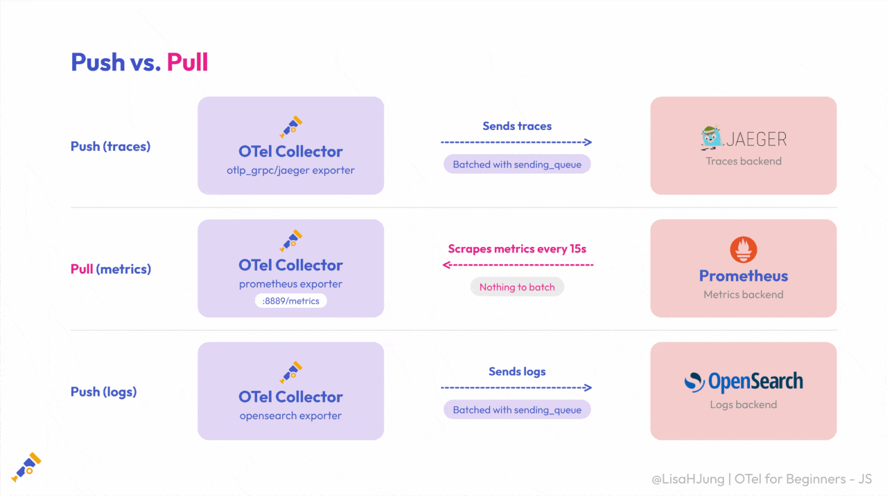

In the metrics episode, we saw that [Prometheus pulls](../metrics/README.md#why-theres-no-batching-for-prometheus) metrics from the Collector. Jaeger and OpenSearch work the other way around. The Collector pushes data to them.

When we push, a sending queue lets the exporter send fewer, larger requests instead of sending telemetry one record at a time.

```yaml
# otel/otel-collector-config.yaml
exporters:
  opensearch:
    http:
      endpoint: http://opensearch:9200
    logs_index: otel-logs
    sending_queue:
      sizer: items
      batch:
        flush_timeout: 5s
        min_size: 512
```

We covered `endpoint` and `logs_index` in the last episode. They tell the Collector where to send our logs and which index to write to.

The new part is `sending_queue`, with the same settings we used for [Jaeger in the traces episode](../traces/README.md#batching-in-the-exporter). The exporter sends a batch once it has 512 log records or after 5 seconds, whichever comes first.

A few dice rolls won't come close to 512 logs, so the batch usually goes out when the timeout hits. That's part of why our logs take a few seconds to show up in OpenSearch.

These settings are only a starting point, so feel free to tune them for your own needs.

### Service

```yaml
# otel/otel-collector-config.yaml
service:
  pipelines:
    # ...traces and metrics pipelines from the earlier episodes...
    logs:
      receivers: [otlp]
      processors: [resource, transform/logs, filter/logs]
      exporters: [debug, opensearch]
```

The `service` section is where everything comes together. Our logs pipeline connects our receiver, our three processors, and our exporters.


Here's how a log travels through it:
- Each roll of the dice sends a log record to the **`otlp`** receiver.
- The log then moves through our processors in the order they're listed.
  - **`resource`** adds our environment and removes the host and process details.
  - **`transform/logs`** checks the dice value and changes rolls of one to `WARN`.
  - **`filter/logs`** drops anything below `WARN`, so only the ones make it through.
- The logs that survive go to both exporters.
  - **`debug`** prints them to the terminal.
  - **`opensearch`** sends them to OpenSearch in batches.

> **Why the order matters.** The filter can only keep our rolls of one because the transform already changed them to `WARN`. If `filter/logs` ran first, every roll would still be `INFO` when it got there, so every log would be dropped.

And that's how we cleaned up, enriched, and filtered our logs, all without changing a single line of our app's code!

# What We Built and Where to Go Next

And that's a wrap on the OpenTelemetry for Beginners JavaScript Journey!

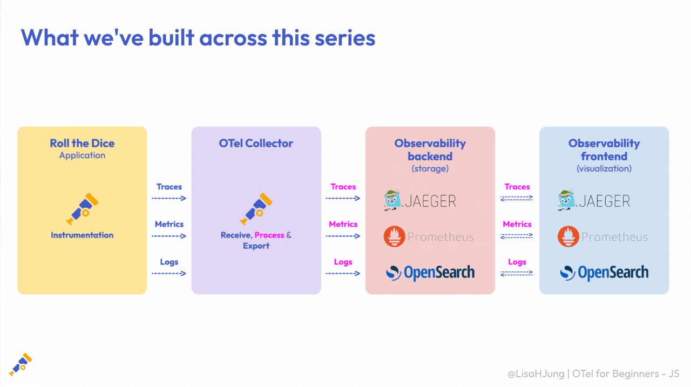

We kicked things off by learning what OpenTelemetry is. From there, we took one signal at a time and built a pipeline for each: traces, then metrics, then logs.

Along the way, we instrumented our app, set up the OTel Collector to receive, process, and export our telemetry, and explored each signal in its own backend.

And here's the best part. **Our app never needed to know where its telemetry was going.**

We decided that in the Collector configuration, without changing a line of application code. That flexibility is one of the best things about OpenTelemetry, and it keeps us from getting locked into a single vendor.

## Where to go from here
- **Try it on your own app.**
  - Instrument one of your own applications and see what its telemetry tells you.
- **Experiment with processors.**
  - The [list of Collector processors](https://github.com/open-telemetry/opentelemetry-collector-contrib/tree/main/processor) is a great place to explore new ways to shape your data.
- **Connect with the community.**
  - If you have questions, the [OpenTelemetry documentation](https://opentelemetry.io/docs/) and the [OpenTelemetry Slack channel](https://opentelemetry.io/community/end-user/slack-channel/) are great places to start.

Thanks so much for joining me on this series. I hope you had fun and picked up something useful along the way!

## Resources
- [OpenTelemetry documentation](https://opentelemetry.io/docs/)
  - Ask AI (⌘+K shortcut)
  - [Language APIs and SDKs](https://opentelemetry.io/docs/languages/)
  - [Logs](https://opentelemetry.io/docs/concepts/signals/logs/)
  - [OpenTelemetry Collector](https://opentelemetry.io/docs/collector/)
    - [List of OpenTelemetry Collector processors](https://github.com/open-telemetry/opentelemetry-collector-contrib/tree/main/processor)
  - [Transform processor (OTTL)](https://github.com/open-telemetry/opentelemetry-collector-contrib/tree/main/processor/transformprocessor)
- [OpenSearch documentation](https://docs.opensearch.org/)
- [OpenTelemetry YouTube channel](https://www.youtube.com/@otel-official)
  - [OpenTelemetry for Beginners series - The JavaScript Journey](https://youtu.be/iEEIabOha8U?feature=shared)
- [OpenTelemetry Slack channel](https://opentelemetry.io/community/end-user/slack-channel/)
