# OpenTelemetry for Beginners - The JavaScript Journey (Metrics)

Getting started with OpenTelemetry can feel overwhelming, but this beginner series for JavaScript developers will guide you step by step.

This guide covers the **metrics** signal and builds on everything we set up in the [Traces walkthrough](../traces/README.md).

> **New to the series?** Start with the [Traces walkthrough](../traces/README.md). It covers what OpenTelemetry is, the pipelines we'll build, the prerequisites, and how to clone the repo. This guide assumes you've completed those steps and can run the Roll the Dice app.

## Resources
- [OpenTelemetry documentation](https://opentelemetry.io/docs/)
  - Ask AI (⌘+K shortcut)
  - [Language APIs and SDKs](https://opentelemetry.io/docs/languages/)
  - [Instrumentation](https://opentelemetry.io/docs/concepts/instrumentation/)
  - [Metrics](https://opentelemetry.io/docs/concepts/signals/metrics/)
  - [OpenTelemetry Collector](https://opentelemetry.io/docs/collector/)
    - [List of OpenTelemetry Collector processors](https://github.com/open-telemetry/opentelemetry-collector-contrib/tree/main/processor)
- [Prometheus documentation](https://prometheus.io/docs/introduction/overview/)
- [OpenTelemetry YouTube channel](https://www.youtube.com/@otel-official)
  - [OpenTelemetry for Beginners series - The JavaScript Journey](https://youtu.be/iEEIabOha8U?feature=shared)
- [OpenTelemetry Slack channel](https://opentelemetry.io/community/end-user/slack-channel/)

# Episode 5 - Metric Instrumentation & Bare-Bones Collector Configuration

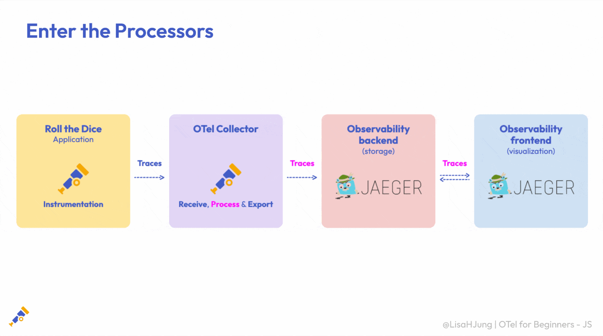

In the previous episodes, we instrumented our app and configured the Collector to receive, process, and export our traces. From there, our traces were stored and visualized in Jaeger.

Now that we've seen how OpenTelemetry works with traces, we'll follow a similar journey with metrics over the next few episodes.

## What is a metric?

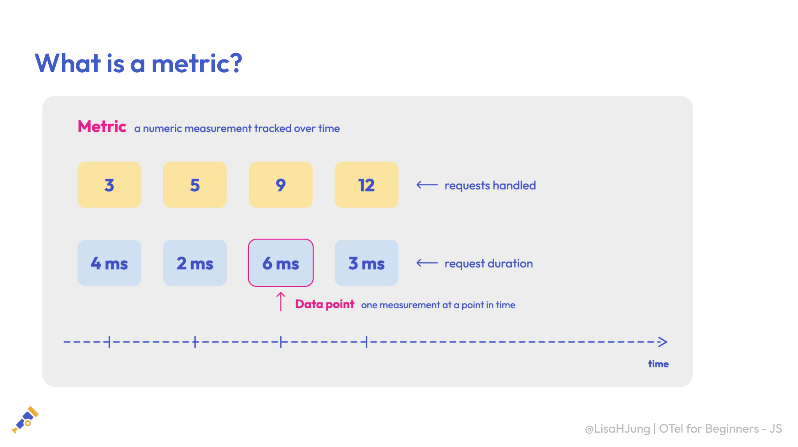

**Metrics** are numbers that tell us how our app behaves over time.

This example shows two metrics, one per row:
- The top row is a running count of the requests our app has handled. It climbs as new requests arrive.
- The bottom row records how long each of those requests took.

Each box is a single value captured at a specific moment, called a **data point**.

Read a row from left to right, and you can watch the values change over time.

This is the key difference between the two signals.

A **trace** shows us what happened during a single request. **Metrics** give us the bigger picture across all requests.

## The bare-bones setup

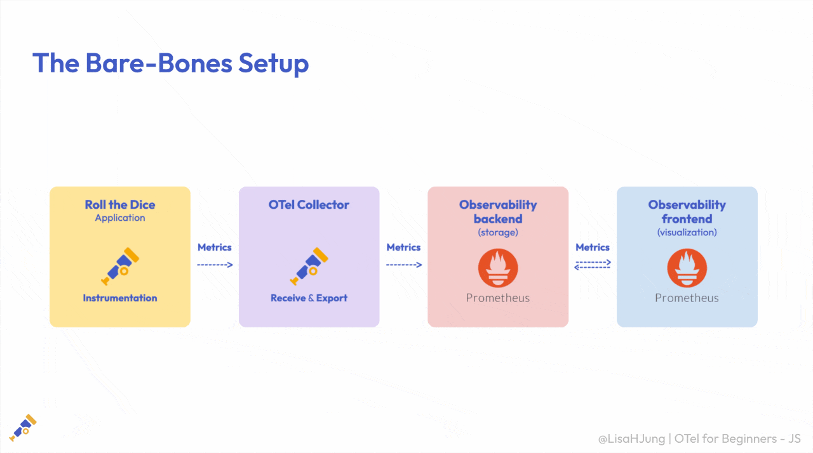

As we did with traces, we'll start simple. 

We'll generate metrics with auto-instrumentation, then configure a bare-bones Collector that receives them and passes them along to **Prometheus**, the backend we'll use to store and explore our metrics.

Before changing anything, we'll explore those metrics in Prometheus to get a feel for what our app collects out of the box.

## Run the learning environment

If you've been following along, you should still have two terminals open. One for the Roll the Dice app and one for Docker.

In each one, we'll stop what's running and move to the `metrics/bare-bones-setup` folder. 

It contains everything this episode needs, including the instrumentation, the Collector configuration, and a Docker setup that now includes Prometheus.

**Terminal 1: restart the app**

> First, press **Ctrl + C** to stop the running app.

```bash
cd ../../metrics/bare-bones-setup
npm install
npm start
```

**Terminal 2: restart the Collector and Jaeger, now with Prometheus**

```bash
docker compose down
cd ../../metrics/bare-bones-setup
docker compose up
```

> **Starting fresh?** From the directory where you cloned the repo, run `cd opentelemetry-for-beginners/javascript/metrics/bare-bones-setup` in each terminal instead. Then run `npm install` and `npm start` in one, and `docker compose up` in the other.

**Generate some metrics**

Once everything is running, head back to the Roll the Dice app at http://localhost:8080/rolldice and refresh the page a few times.

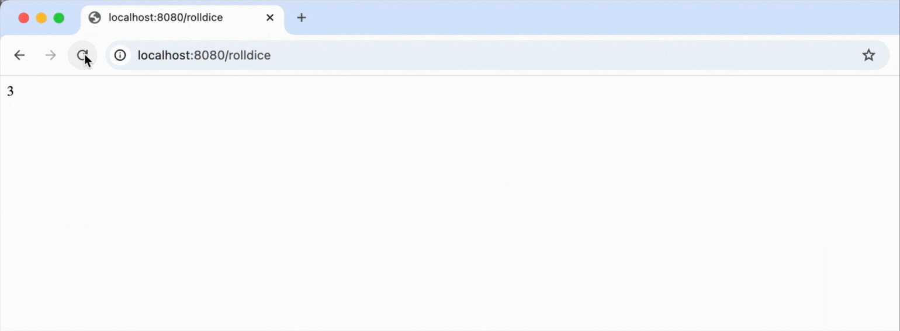

While you refresh, keep an eye on the terminal running Docker. That's where the Collector prints the metrics it receives.

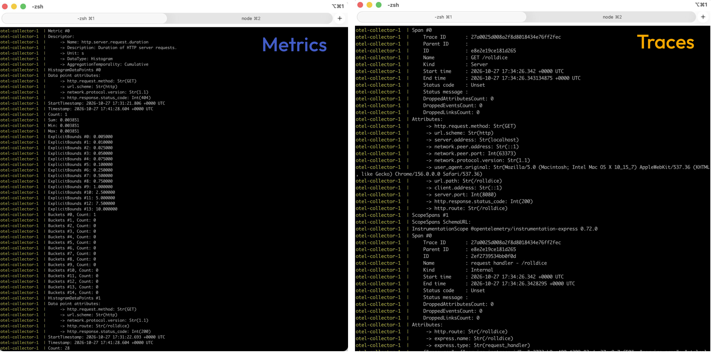

**Metrics**
- Runtime metrics, like memory usage, appear on their own, even before any requests come in.
- HTTP request metrics show up once we start rolling the dice.

**Traces**
- Spans appear here too, because our traces pipeline is still running alongside the new one.

Our app is now sending both traces and metrics to the Collector. 

Next, let's look at the setup that makes the metrics possible.

> **Quick heads-up.** To keep things easy to follow, some of the code snippets below only show the metrics-related bits. Your actual files also include the traces setup from the earlier episodes, in `instrumentation.js` and the Collector config. We've just trimmed it out here so it's easier to focus on metrics.

## The OTel packages

Open the `javascript/metrics/bare-bones-setup` folder in your code editor, then open `package.json`.

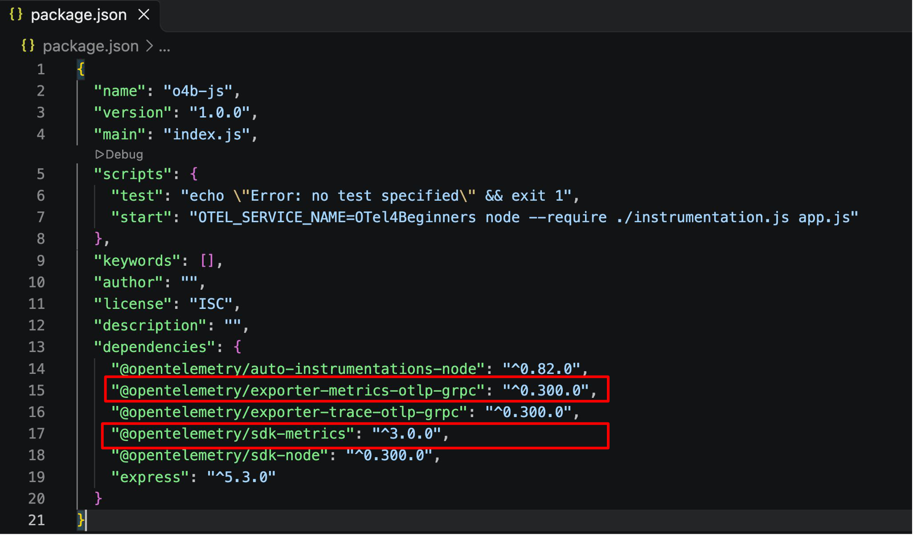

You'll recognize most of these packages from the traces setup. Two are new, and both are there for metrics:

- **`@opentelemetry/sdk-metrics`** is the Metrics SDK. It gathers the metrics our app records.
- **`@opentelemetry/exporter-metrics-otlp-grpc`** is the OTLP metric exporter. It ships those metrics to the Collector over gRPC.

To see how the two fit together, open `instrumentation.js`.

## instrumentation.js

This file should look familiar from the traces setup, with the metrics pieces added.

```js
const opentelemetry = require('@opentelemetry/sdk-node');

const {
  getNodeAutoInstrumentations,
} = require('@opentelemetry/auto-instrumentations-node');

const {
  OTLPMetricExporter,
} = require('@opentelemetry/exporter-metrics-otlp-grpc');

const {
  PeriodicExportingMetricReader,
} = require('@opentelemetry/sdk-metrics');

const sdk = new opentelemetry.NodeSDK({
  // ...trace configuration from the earlier episodes...
  metricReaders: [
    new PeriodicExportingMetricReader({
      exporter: new OTLPMetricExporter({
        url: 'http://localhost:4317',
      }),
      exportIntervalMillis: 10000,
    }),
  ],
  instrumentations: [
    getNodeAutoInstrumentations({
      '@opentelemetry/instrumentation-router': { enabled: false },
    }),
  ],
});

sdk.start();
```

It does four main things:

1. **Imports the packages we need.**
   - Along with the OTel SDK and auto-instrumentation, we bring in the OTLP metric exporter and a metric reader from the Metrics SDK.
2. **Creates a Node SDK instance** and enables auto-instrumentation.
   - No extra setup is needed here. The auto-instrumentation that gave us traces also records metrics, like request duration and memory usage.
3. **Exports our metrics** to the Collector.
   - This is what's new. The metric reader gathers the latest values every ten seconds (`exportIntervalMillis: 10000`) and hands them to the exporter.
   - The exporter then sends them to the Collector on port `4317`, the same port our traces use.
4. **Starts the SDK** so our app can generate and send metrics.

That covers the app side. We've seen how our app generates metrics and sends them to the Collector.

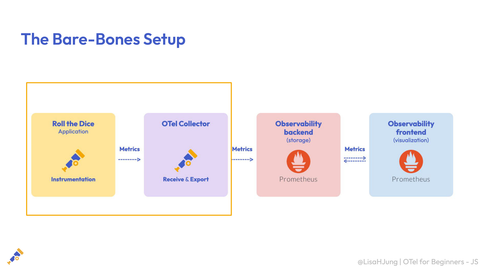

## Collector configuration

Now let's look at the other half of the pipeline, where the Collector takes in those metrics and hands them off to our backend. 

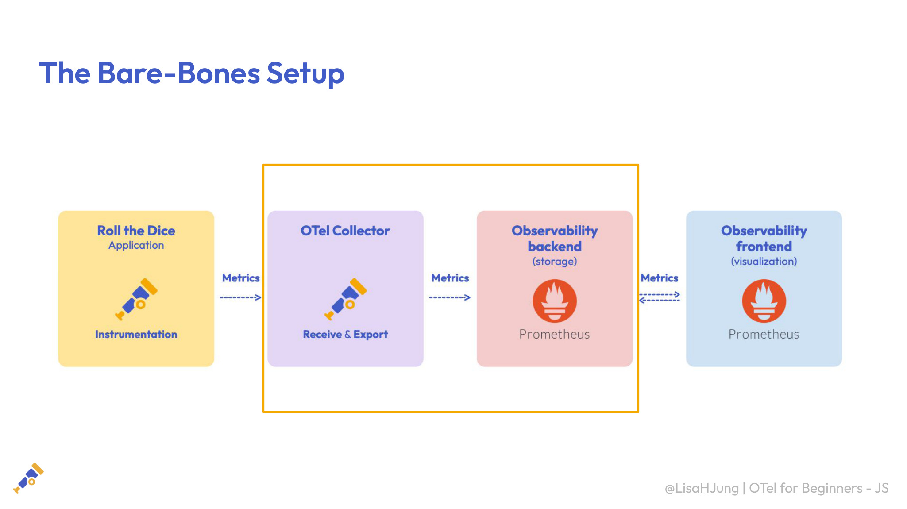

In your code editor, open `otel/otel-collector-config.yaml`.

```yaml
# otel/otel-collector-config.yaml
receivers:
  otlp:
    protocols:
      grpc:
        endpoint: 0.0.0.0:4317
      http:
        endpoint: 0.0.0.0:4318

exporters:
  debug:
    verbosity: detailed

  otlp_grpc/jaeger:
    endpoint: jaeger:4317
    tls:
      insecure: true

  prometheus:
    endpoint: 0.0.0.0:8889

service:
  pipelines:
    traces:
      receivers: [otlp]
      exporters: [debug, otlp_grpc/jaeger]
    metrics:
      receivers: [otlp]
      exporters: [debug, prometheus]
```

We're keeping this configuration bare-bones, so it only has receivers, exporters, and service pipelines.

The layout should look familiar from the trace episodes, and the receiver hasn't changed at all. What's new lives in the exporters and the metrics pipeline.

### Exporters

```yaml
# otel/otel-collector-config.yaml
exporters:
  debug:
    verbosity: detailed

  prometheus:
    endpoint: 0.0.0.0:8889
```

Exporters decide where the Collector sends our telemetry. For metrics, we're using two of them.

- The **`debug`** exporter is the same one we used for traces. This time, it prints our metrics to the Collector's output.
- The **`prometheus`** exporter is the new addition. It exposes our metrics on port `8889`.
  - Instead of the Collector pushing metrics out, Prometheus visits that endpoint on a regular schedule and pulls them in. This is called **scraping**, and in our setup it happens every 15 seconds, as set in `otel/prometheus.yaml`.
  - Once Prometheus has our metrics, we can query and graph them in its UI.

### Service

```yaml
# otel/otel-collector-config.yaml
service:
  pipelines:
    traces:
      receivers: [otlp]
      exporters: [debug, otlp_grpc/jaeger]
    metrics:
      receivers: [otlp]
      exporters: [debug, prometheus]
```

The `service` section now has two pipelines, one for traces and one for metrics. The traces pipeline sends traces to Jaeger, and the metrics pipeline sends metrics to Prometheus.

In our metrics pipeline:
- The **`otlp`** receiver accepts the metrics our app sends every ten seconds and passes them to both exporters.
- The **`debug`** exporter prints them to the terminal.
- The **`prometheus`** exporter exposes them on port `8889`, ready for Prometheus to scrape.

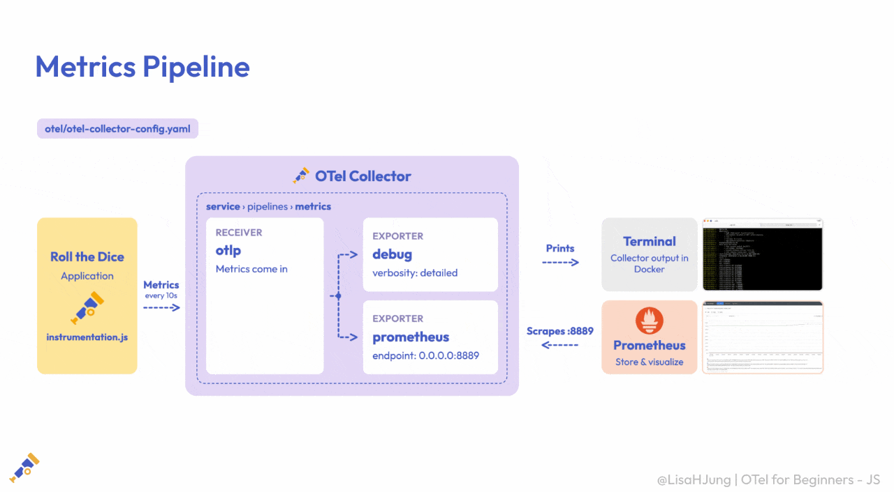

That's the path our metrics take. But what can they actually tell us about our app?

## Metrics in a coffee shop

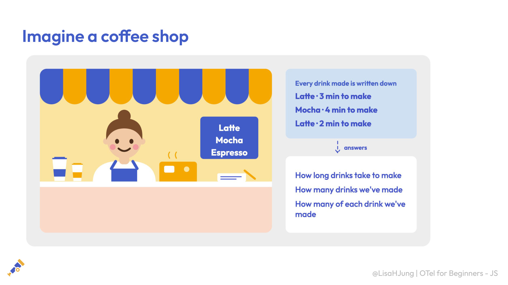

Let's step away from the code for a moment and picture a coffee shop. Each time a drink is made, someone notes what it was and how long it took.

So far, that's a latte in three minutes, a mocha in four, and another latte in two. 

From those notes alone, we know how many drinks we've made and how fast we're serving them. Count lattes and mochas separately, and we also learn which drinks people order most.

Those numbers are metrics, and they give us a quick read on how the shop is doing.

## Metrics in our app

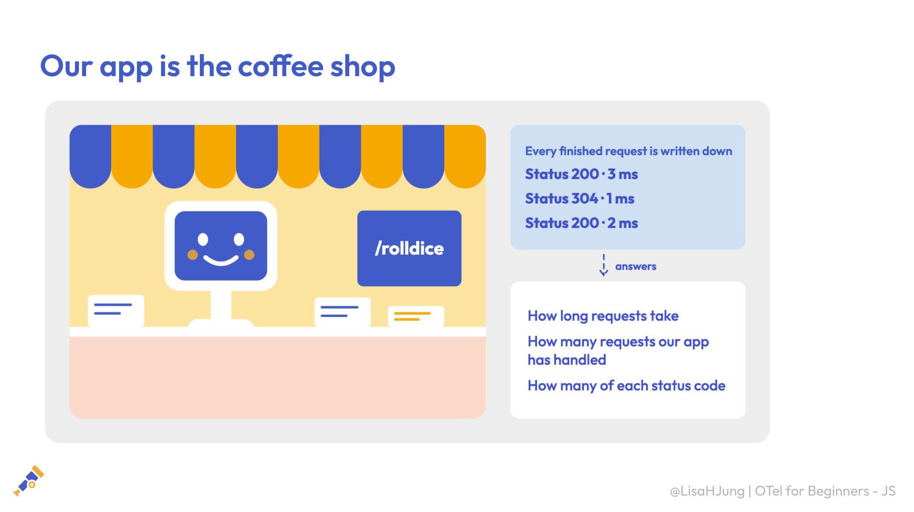

Our app works the same way, except it serves requests instead of drinks. Whenever a request finishes, the app notes its route, its status code, and how long it took.

- Counting requests tells us how busy our app is.
- Timing them tells us how quickly it responds.
- Grouping them by status code shows how many succeeded and how many failed.

Put together, these metrics paint a picture of how our app is performing. 

Let's find them in Prometheus.

## Explore our metrics in Prometheus

**1. Open the Prometheus UI**

Go to http://localhost:9090. We'll spend the rest of this episode here, exploring our metrics.

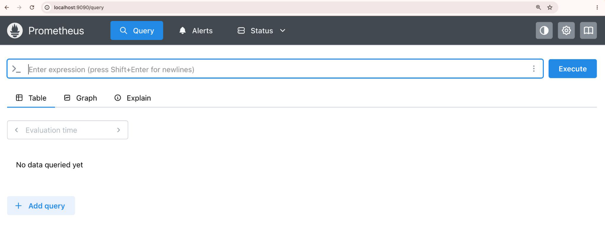

**2. Run a query**

We'll begin with a simple question. How many requests has our app handled?

Type this query into the query bar at the top of the page:

```
http_server_request_duration_seconds_count
```

This is a metric that auto-instrumentation created for us. Entering its name tells Prometheus which metric we want to see. It's a mouthful, so let's break this down. 

Think back to how we timed each drink in the coffee shop. Our app times its requests the same way, and that's what **`http_server_request_duration_seconds`** describes. The `_seconds` part tells us the unit of measurement.

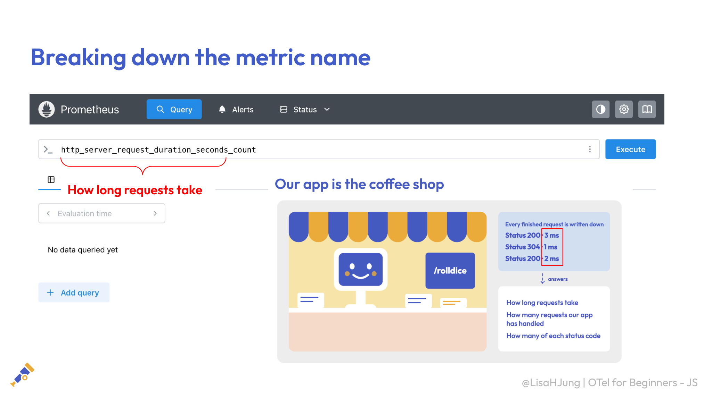


Count up those durations, and we know how many requests our app has handled. In this example, that's three. That's the **`_count`** part of the name.

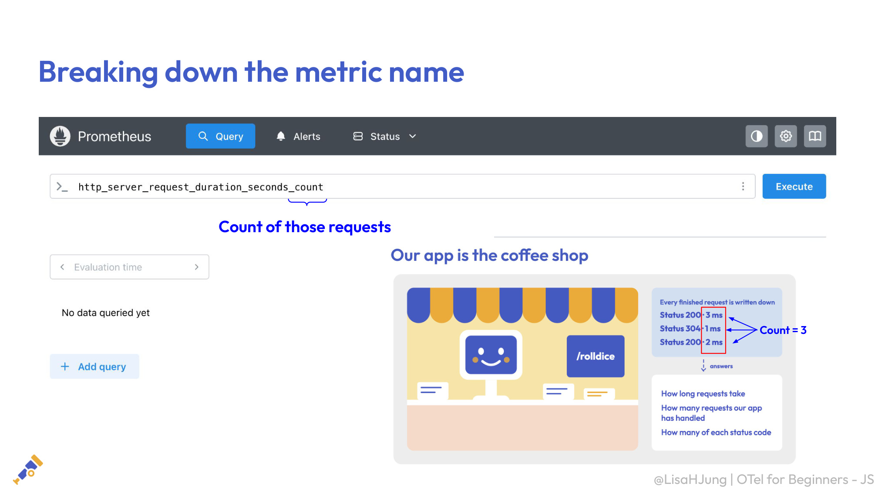

Read as a whole, the query asks, "How many requests has our app handled since it started?" Now click **Execute**.

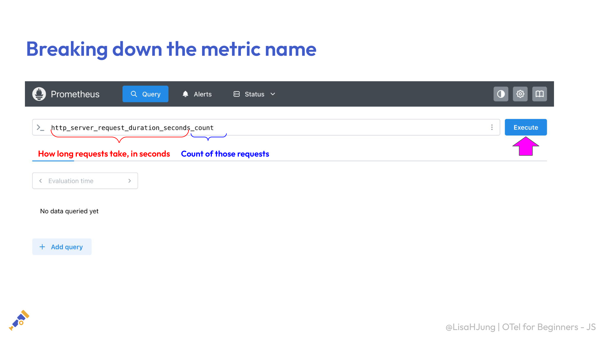

**3. Read the results in Table view**

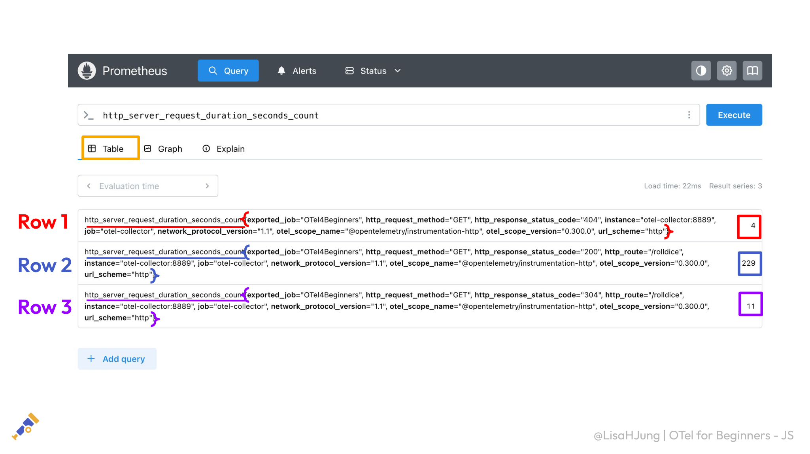

The results open in **Table** view. 

Rather than a single total, Prometheus returns three rows. Each one begins with the metric name, lists some details inside curly braces, and ends with a count on the right.

Why split the requests into groups? Our coffee shop can help explain.

### Labels

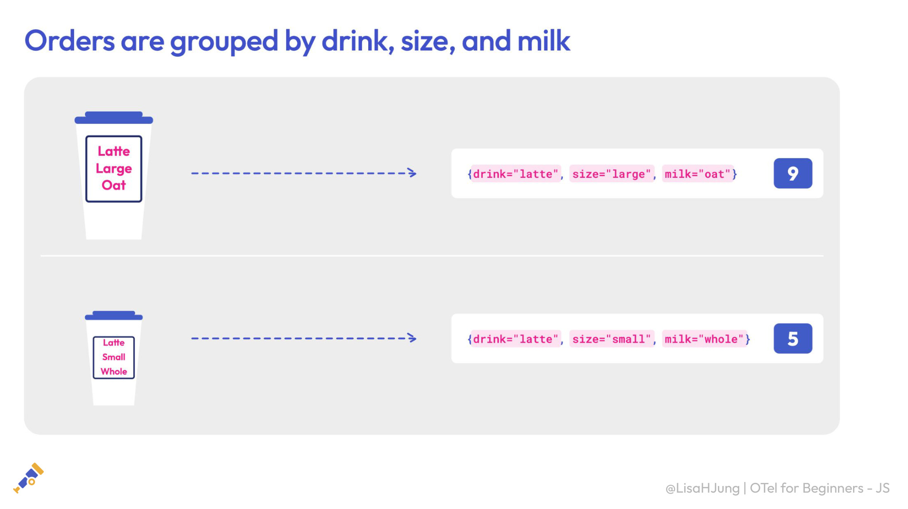

A single total doesn't tell a coffee shop much. So instead, we keep separate counts by drink, size, and milk. All the large oat lattes share one count, and small lattes with whole milk get another.

Splitting things up like this lets us ask sharper questions. Here, large oat lattes are outselling small whole milk lattes, which tells us to stock up on oat milk.

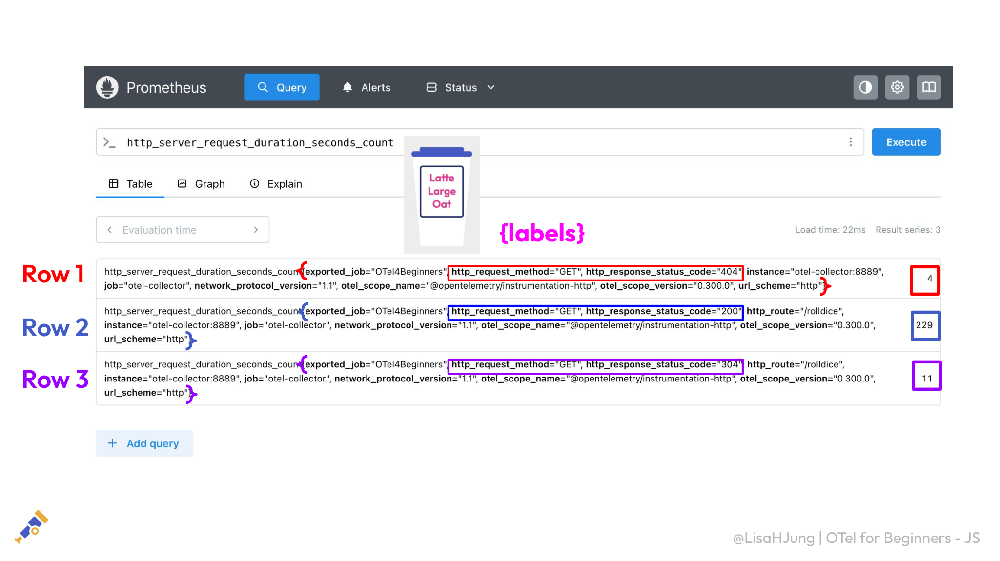

Our app groups its requests in a similar way. Instead of drink, size, and milk, it uses details like the HTTP method and status code. Those are the details inside the curly braces.

They work like the label on a coffee cup that describes the order, and in Prometheus, they're called **labels** too. Every unique combination of labels gets a row, and a count, of its own.

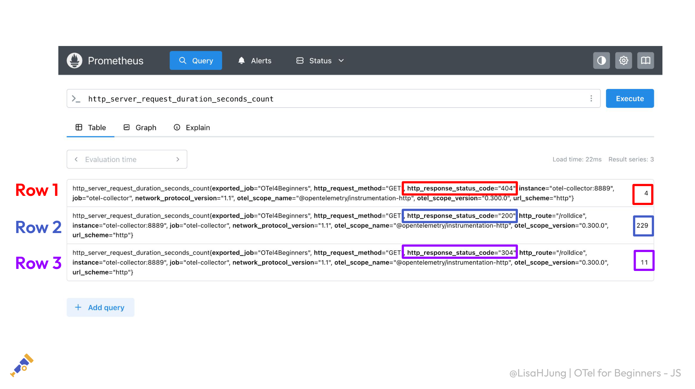

Take the status code label. Just as each drink size had its own count, each status code has its own row. In our example, we have:
- **4** failed requests with a `404`
- **229** successful requests with a `200`
- **11** requests with a `304`

> Your counts will be different. They depend on how many times you've refreshed the app.

Thanks to this grouping, we can tell at a glance how many requests succeeded and how many failed.

**4. Switch to Graph view**

Table view gives us a snapshot of each group's count. Those counts keep changing as requests come in, so click **Graph** to watch them over time.

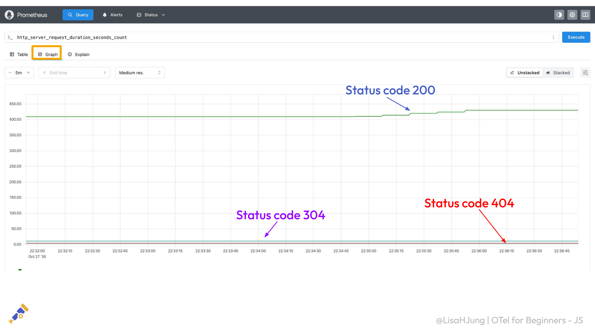

Every line here matches one of the rows from Table view. Rather than just the latest count, it shows how that count has changed over time. A line of values like this is called a **time series**.

Try it yourself. Roll the dice a few more times, give it about 30 seconds, then click **Execute** again. You'll see the line for successful requests step up.

Three groups give us three time series. So what happens when we add more labels?

### Cardinality

Let's return to the coffee shop one last time. Our two groups of drinks each have a count that changes over time, which makes two time series.

The number of time series we have is called **cardinality**, so the shop's cardinality is two.

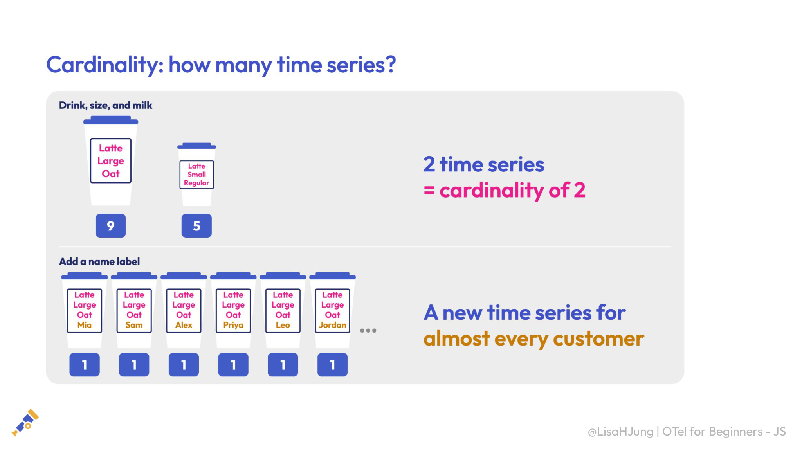

Now say we add each customer's name as a label. 

The single count for large oat lattes would break into a separate count for every customer who ordered one. Each new customer adds another time series, and that's how one label with lots of different values can drive cardinality up.

Our app follows the same rule. 

The query returned three time series, giving it a cardinality of three. Prometheus also shows this number next to **Result series**.

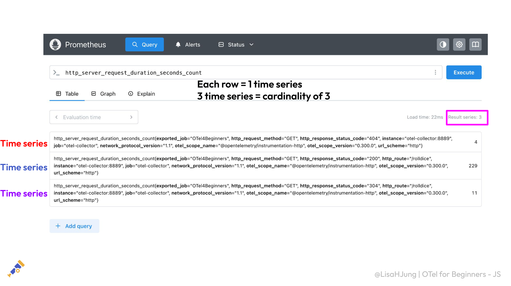

Every new combination of label values adds a time series, and every time series is more data to store. 

Over time, that can add up to higher costs. In the next episode, we'll see how the Collector can help us decide what data to keep.

### Resource attributes

Labels describe the requests themselves. **Resource attributes** describe something different, which is where our metrics came from.

We first met them with [traces](../traces/README.md#process-resource-attributes). They tell us about the service, host, and process behind our telemetry.

Most of them don't show up as labels on our metrics in Prometheus, so we'll find them in the Collector's debug output instead. In the terminal running Docker, search for `ResourceMetrics`. The resource attributes for our metrics are listed right below it.

The output moves fast, so here's a screenshot to follow along with:

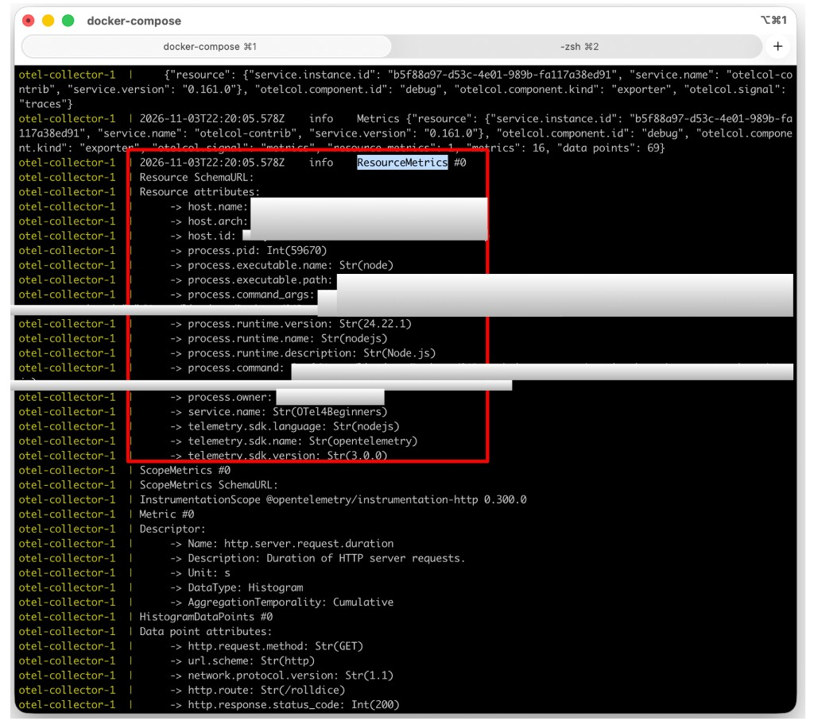

A few of these are genuinely useful. `service.name`, for example, tells us which service sent the data.

Others are more than we need for this demo, like host identifiers, the process owner, and the full command used to start the app. Their values are blurred in the screenshot, but you can still see which attributes were added automatically.

In the next episode, we'll use processors to remove these:
- `host.arch`
- `host.id`
- `host.name`
- `process.command`
- `process.command_args`
- `process.executable.path`
- `process.owner`
- `process.pid`

And that's our metrics pipeline up and running! 


We generated metrics with auto-instrumentation, sent them through a bare-bones Collector, and explored them in Prometheus, along with the labels and resource attributes that come with them.

Next, we'll put that pipeline to work. 

In the next episode, we'll add processors to clean up, enrich, and filter our metrics before they leave the Collector.

# Episode 6 - Processing Metrics: OpenTelemetry Collector in Action

In the last episode, we set up our app to generate metrics and a bare-bones OTel Collector to get them to Prometheus.

We also spotted [resource attributes](#resource-attributes) we don't need, like host identifiers, the process owner, and the command used to start our app. Some could reveal sensitive information. Others just aren't useful for our demo.

And we saw how [more time series](#cardinality) means more data to store, which can increase costs.

In this episode, we'll clean things up using **processors**.

## Processing metrics with the OpenTelemetry collector

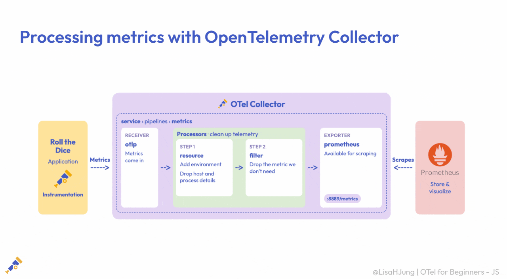

Just like we did with traces, we'll make these changes inside the Collector, before our metrics reach Prometheus.

We'll use two processors:
- The **`resource`** processor removes resource attributes we don't need.
- The **`filter`** processor drops a metric we don't want to keep.

We'll also look at how Prometheus collects our metrics and how that differs from sending traces to Jaeger.

All of this happens in the Collector, so we won't need to touch our app's code.

## Project folders

1. `javascript/metrics/bare-bones-setup/` (**Episode 5**)
   - Instruments the Roll the Dice app and sends metrics to the Collector.
   - The Collector exports metrics to Prometheus with no additional processing.

2. `javascript/metrics/add-processors/` (**Current episode**)
   - Uses the same app and instrumentation as `bare-bones-setup`.
   - Adds processors to the Collector configuration that clean up our resource attributes and drop a metric we don't need.

## Run the updated setup

You should still have two terminals open, one for the Roll the Dice app and one for Docker.

In each one, we'll stop what's running and switch to the `metrics/add-processors` folder. Restarting the Collector loads our new configuration, including the processors we'll explore in this episode.

**Terminal 1: restart the app**

> First, press **Ctrl + C** to stop the running app.

```bash
cd ../add-processors
npm install
npm start
```

The `add-processors` folder has its own dependencies, so we run `npm install` before starting the app.

**Terminal 2: restart the Collector, Jaeger, and Prometheus**

```bash
docker compose down
cd ../add-processors
docker compose up
```

**Generate some metrics**

Once everything's running, head back to the Roll the Dice app at http://localhost:8080/rolldice and refresh the page a few times.


As you refresh, keep an eye on the terminal running Docker. You'll see metrics and spans coming through the Collector, just like last time.

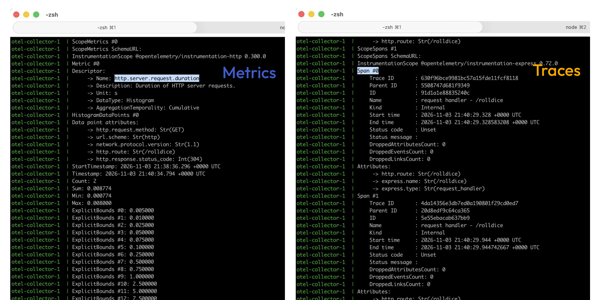

The difference from the last episode is that they now pass through our processors before they're exported.

Let's look at the configuration to see what's changed.

## Collector configuration

In your code editor, open the `javascript/metrics/add-processors` folder. Then open `otel/otel-collector-config.yaml`.

> **Quick heads-up.** Just like in the last episode, the snippets below only show the metrics-related bits. Your actual file also includes the `attributes/traces` processor and the traces pipeline from the earlier episodes. We've just trimmed them out here so it's easier to focus on metrics.

```yaml
# otel/otel-collector-config.yaml
receivers:
  otlp:
    protocols:
      grpc:
        endpoint: 0.0.0.0:4317
      http:
        endpoint: 0.0.0.0:4318

processors:
  resource:
    attributes:
      - key: deployment.environment.name
        value: local
        action: insert
      - key: host.arch
        action: delete
      - key: host.id
        action: delete
      - key: host.name
        action: delete
      - key: process.command
        action: delete
      - key: process.command_args
        action: delete
      - key: process.executable.path
        action: delete
      - key: process.owner
        action: delete
      - key: process.pid
        action: delete

  filter/exclude_metrics:
    error_mode: ignore
    metrics:
      metric:
        - 'name == "v8js.memory.heap.space.physical_size"'

exporters:
  debug:
    verbosity: detailed

  otlp_grpc/jaeger:
    endpoint: jaeger:4317
    tls:
      insecure: true
    sending_queue:
      sizer: items
      batch:
        flush_timeout: 5s
        min_size: 512

  prometheus:
    endpoint: 0.0.0.0:8889

service:
  pipelines:
    metrics:
      receivers: [otlp]
      processors: [resource, filter/exclude_metrics]
      exporters: [debug, prometheus]
```

Our bare-bones configuration had receivers, exporters, and a `service` section. Now we've added a fourth section, `processors`.

Our metrics pipeline uses two processors. The `resource` processor will look familiar from traces. The `filter` processor is new.

Let's start with the `resource` processor.

### The resource processor

We've already used the `resource` processor for [traces](../traces/README.md#the-resource-processor). Here, both pipelines share the same `resource` processor, so it makes the same changes to our traces and metrics.

**Add the environment**

```yaml
# otel/otel-collector-config.yaml
processors:
  resource:
    attributes:
      - key: deployment.environment.name
        value: local
        action: insert
```

First, it uses the `insert` action to add `deployment.environment.name` with the value `local`.

That tells us which environment our telemetry came from.

**Remove host and process details**

```yaml
# otel/otel-collector-config.yaml
processors:
  resource:
    attributes:
      - key: host.arch
        action: delete
      - key: host.id
        action: delete
      - key: host.name
        action: delete
      - key: process.command
        action: delete
      - key: process.command_args
        action: delete
      - key: process.executable.path
        action: delete
      - key: process.owner
        action: delete
      - key: process.pid
        action: delete
```

Then, it uses the `delete` action to remove the host and process attributes we spotted in the [last episode](#resource-attributes).

**Before and after**

Most resource attributes don't show up as labels on our metrics in Prometheus, so like last episode, we'll check them in the Collector's output.

In the terminal running Docker, search for `ResourceMetrics`. The resource attributes for our metrics are listed right below it.

If the output moves too quickly, you can follow along with the screenshot below.

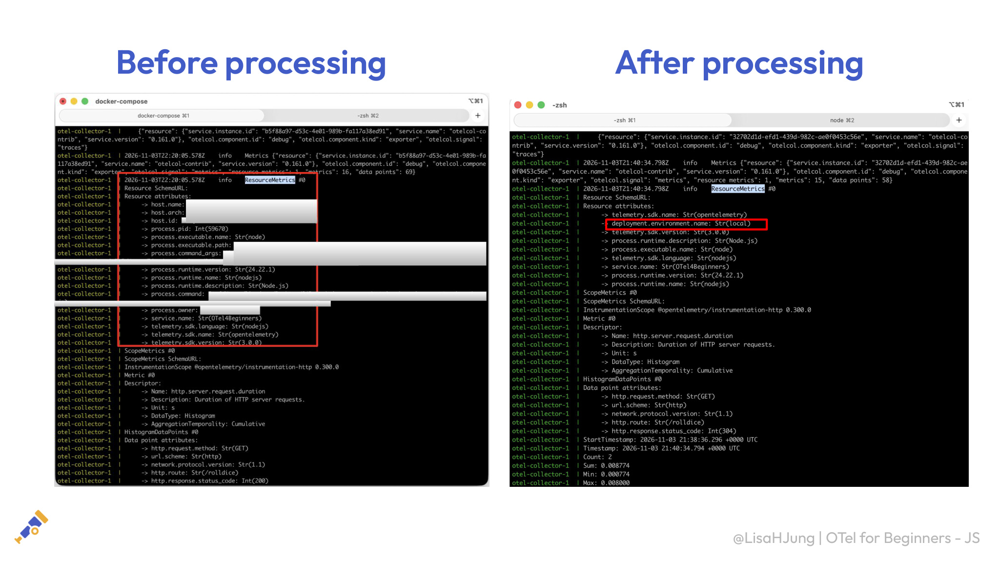

On the left is the raw output from our bare-bones setup, and on the right is the same block after processing.

Two things changed:
- `deployment.environment.name` now appears with the value `local`.
- The host and process attributes we deleted are gone.

Everything else, like `service.name` and the runtime information, stays the same because the `resource` processor only changes what we tell it to.

### The filter processor

```yaml
# otel/otel-collector-config.yaml
processors:
  filter/exclude_metrics:
    error_mode: ignore
    metrics:
      metric:
        - 'name == "v8js.memory.heap.space.physical_size"'
```

Next, let's look at the `filter` processor. We haven't used this one before.

The `resource` processor changes the details attached to our telemetry. The `filter` processor lets us drop telemetry we don't need.

Here, we're dropping a whole metric called `v8js.memory.heap.space.physical_size`. It measures the size of memory areas in V8, the JavaScript engine that runs our app.

We don't need that much memory detail for this demo, so we'll leave it out. That gives us less data to store and query, which can help keep costs down.

Here's how the configuration works:
- Under **`metrics`**, each entry in the **`metric`** list is a condition. Any metric that matches a condition gets dropped. Ours matches the metric by its name.
- **`error_mode: ignore`** tells the Collector to log any condition that fails and keep going, instead of stopping on the error.
- The **`/exclude_metrics`** part of the name works the same way as `/traces` in `attributes/traces`. It's a name we chose to describe what this processor does.

**Before and after**

To see the filter in action, let's compare this metric in Prometheus before and after processing.

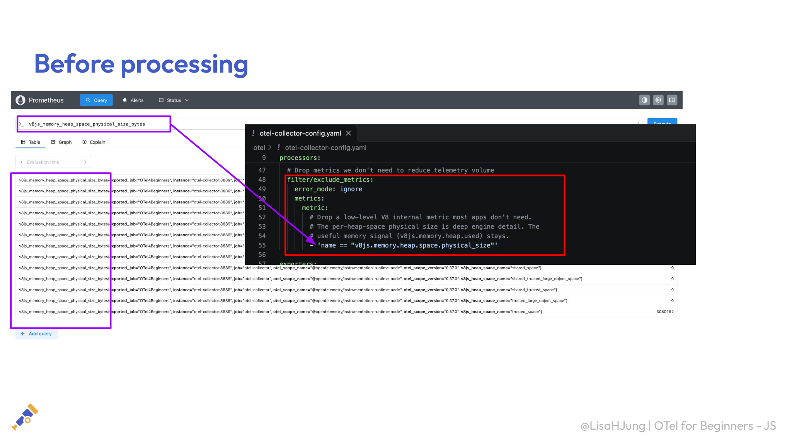

Here's the before view from our bare-bones setup. We queried `v8js_memory_heap_space_physical_size_bytes` in Prometheus, and it returned one row for each memory area in V8.

Notice that the name looks a little different from the one in our config. The Prometheus exporter replaces dots with underscores. It also adds the unit at the end, which is `_bytes` here.

Now let's run the same query in the live Prometheus UI. Go to http://localhost:9090 and type this query into the query bar at the top of the page:

```
v8js_memory_heap_space_physical_size_bytes
```

Then click **Execute**.

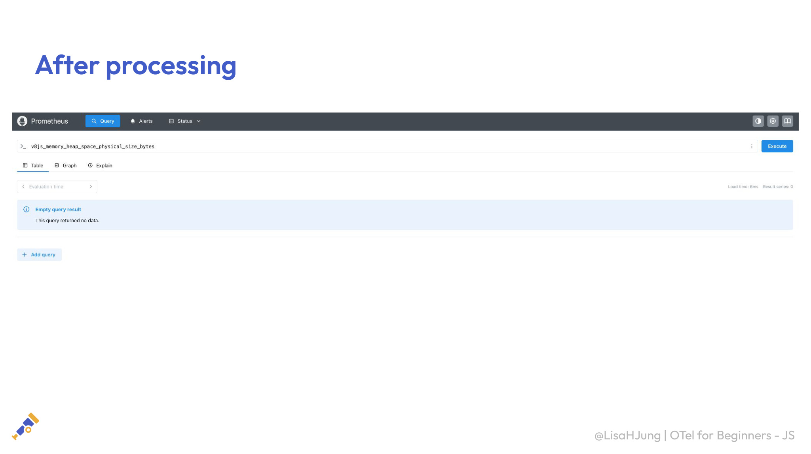

This time, Prometheus comes back empty. That's because the `filter` processor drops this metric inside the Collector, so it never reaches Prometheus.

And since we only targeted this one metric, the rest of our memory metrics are still there. Try querying `v8js_memory_heap_used_bytes` to see one of them.

That covers both of our processors. Before we see how they fit into the pipeline, let's scroll down to the exporters.

### Why there's no batching for Prometheus

```yaml
# otel/otel-collector-config.yaml
exporters:
  debug:
    verbosity: detailed

  otlp_grpc/jaeger:
    endpoint: jaeger:4317
    tls:
      insecure: true
    sending_queue:
      sizer: items
      batch:
        flush_timeout: 5s
        min_size: 512

  prometheus:
    endpoint: 0.0.0.0:8889
```

You might notice something missing from our `prometheus` exporter.

We configured [batching](../traces/README.md#batching-in-the-exporter) for the `otlp_grpc/jaeger` exporter in the traces episode, but not for Prometheus.

That's because Jaeger and Prometheus get their data in different ways.

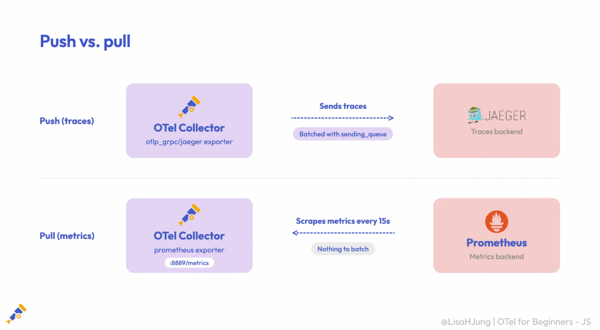

With Jaeger, the Collector **pushes** traces to the backend. Batching lets it send fewer, larger requests.

With Prometheus, it works the other way around. The Collector makes our metrics available on port `8889`, and Prometheus **pulls** them in on its own schedule. That's what we mean by scraping.

We set that schedule in Prometheus's own configuration file, `otel/prometheus.yaml`:

```yaml
# otel/prometheus.yaml
global:
  scrape_interval: 15s
```

The `scrape_interval` tells Prometheus to collect our metrics from the Collector every 15 seconds.

Since Prometheus decides when to collect the metrics, the Collector doesn't push anything, so there's nothing to batch on the way out.

### Service

```yaml
# otel/otel-collector-config.yaml
service:
  pipelines:
    metrics:
      receivers: [otlp]
      processors: [resource, filter/exclude_metrics]
      exporters: [debug, prometheus]
```

As we saw in the last episode, the `service` section is where everything comes together.

Our metrics pipeline connects our receiver, our two processors, and our exporters. Listing the processors here is what turns them on, and they run in the order we list them, `resource` first, then `filter/exclude_metrics`.

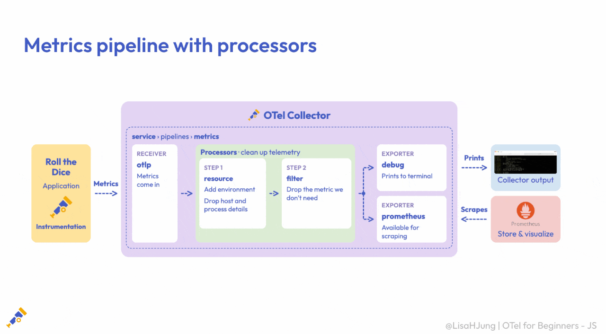

Let's put it all together.
- Every ten seconds, our app sends metrics to the **`otlp`** receiver.
- The **`resource`** processor adds our environment and drops the host and process details.
- The **`filter/exclude_metrics`** processor drops the metric we don't need.
- The **`debug`** exporter prints the remaining metrics to the terminal.
- The **`prometheus`** exporter makes them available for Prometheus to scrape.

And that's how we cleaned up and filtered our metrics, all without changing a single line of our app's code!

In the next episode, we'll move on to our third signal, logs. We'll instrument our app for logs and build a bare-bones pipeline for them.
